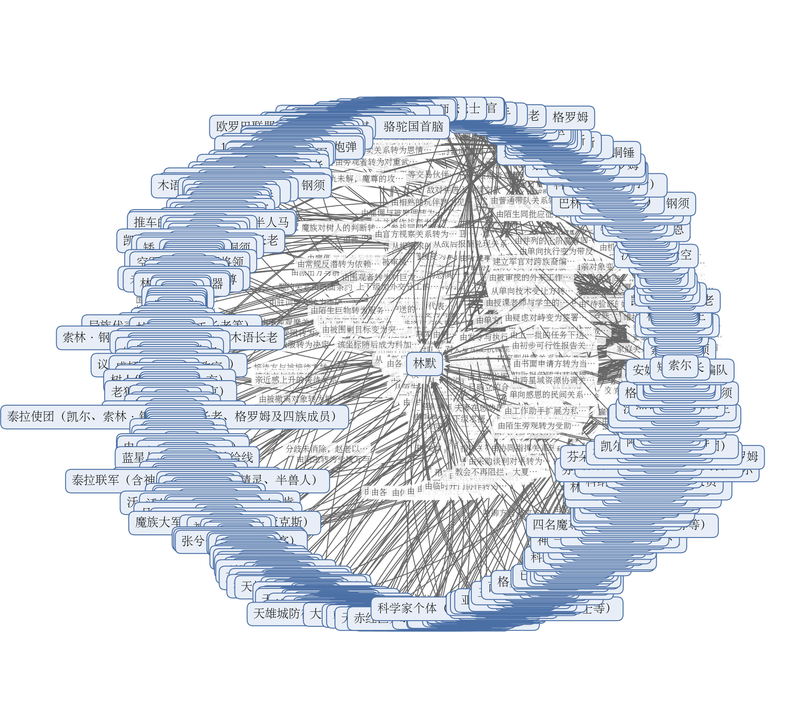

# 拆文报告：末日迁徙异界，国家钢铁洪流开路

> 一句话：一个末日里的底层青年把"我能穿越异界"上交国家，从此这本书的主角不是他一个人，而是一整个国家——读者追的是"这一次，国家能拿出什么"。
> 拆到哪：全书 907 章、约 187.8 万字，全部拆完。

## 基本信息

| 书名 | 题材 | 总章数 | 总字数 | 目标平台 |
|------|------|--------|--------|----------|
| 末日迁徙异界，国家钢铁洪流开路 | 上交国家 / 异界穿越 / 科技对魔法 / 两界发展（末世+轻群像） | 907章（连载中） | 约187.8万字 | 番茄小说 |

## 核心发现

**一、真正的金手指不是"变强"，是"他本人就是那条通道"。**

第67章原文用一句话把全书的资源逻辑钉死了："他本人是空间链接"。这意味着国家不需要培养他变强，只需要他站在两个世界之间，然后把门一次一次做大。读者于是不看主角打怪升级，改看"门这次能开多大"——第259章永久星界传送门显现并扩到九十米，第481章他自己开的门扩到三十五米，第588章南极门扩成两百米巨门后海陆空三线同时开火，第852章魔族把虫洞直径突破四千米。你写书时可以直接用：**把金手指设计成"基础设施"而不是"战力"**，这样后面所有的宏大场面都不用额外解释资源从哪来，而且主角越弱越安全，读者的安全感反而越强。

**二、爽点的主引擎是"让对手自己动手验证"，不是让主角宣布。**

这本书三百多章反复跑同一个套路：主角拿出一件东西，权威先骂、再亲手试、试完失态、失态之后倒戈。第19-20章精灵锻造大师艾尔德当众试射复合弓，满弓卸力惊到他，一箭贯穿精钢靶后老泪纵横、跪称圣者；第287-288章矮人高层逐一探查坦克的CPU盖板，集体破防崩溃；第766章科纳守望者派船验轨十一小时才肯验收通过。全书统计下来，"掉马震惊"这一个套路在约 280 章里反复出现（见 `剧情/情绪模块.md`）。你写书时可以怎么用：**把"强"写成别人的失态，而不是自己的旁白**；同时记得每隔几十章换一次冲击物的量级——从一颗宝石、到CPU盖板、到行星级工业、到文明级技术，否则读者会提前预判。

**三、每一次胜利都当场结算代价，账目比战果更长。**

第454章的战损报表逐条念出：巨龙阵亡六百一十二头、神圣人族十八万、精灵与半兽人各十万、大夏五千，总体伤亡五分之一。第811章广场默哀后两位烈士被点名，全场起立敬礼。第800-802章六股湮灭威能抹掉整个西北防区，连同上百台盘古机甲与两名驾驶员一并损失，确认击毙后是全体起立致敬而不是欢呼。这些段落把"爽"和"疼"放在同一场戏里互相抵消，所以读者不会麻木。你写书时可以怎么用：**在每一波大爽之后立刻给一份有名有姓的账单**，并把无名者写成有名字的人，情绪补偿才成立。反过来要注意：代价段落不能扎堆，本书用第590-591章的工业秩序感、第504-517章的百姓过门、第892-907章的基层治理来对冲，否则情绪会一路下沉。

**四、威胁的换代由反派自己开会完成，主角常常是最后知道的。**

这本书里最有张力的信息差，全在反派侧的会议室里。第492-495章亚克斯用蓝星坐标换命，科加斯记下坐标后撤军毁洞；第732章科加斯把"智慧文明坐标"当商品卖给另外两尊魔神；第764章亚克斯点出"蓝星坐标如今只剩科加斯知道"，科加斯立刻意识到这桩机密能换钱；第840-842章三份坐标一天之内全部售出。而大夏直到第844章三线空间波动亮起才被动确认——这中间隔着 111 章的读者信息优势（见 `剧情/节奏.md` 的关键信息推进表）。你写书时可以怎么用：**让反派主动出牌**（交易、结盟、转卖情报）比让主角找上门省篇幅，也更容易制造持续的悬念压迫；代价是反派容易被写成只会算账的生意人，所以必须用实际战果（第757、802、858章三次魔神陨落）和未收束的魔皇级威胁定期重置威慑。

**五、文明融合的进度条是"身份"，不是"战绩"。**

异族在这本书里走了一条完整的升级路径：客户 → 盟友 → 受训盟友 → 联军 → 入籍 → 自治区居民。第189章血签《泰拉联盟战略条约》划出封地；第880-881章格罗姆宣布整族并入、沃里克拍桌补上"趁筹码还在"的存续理由；第890-891章国庆阅兵上宣读两族加入确认书，赵老宣布两族入夏；第893章基层工作组靠"登记与领物分开"让半兽人排起队。每一步都用可查的文书与仪式固定下来。你写书时可以怎么用：**跨族融合要写"从商业关系升级为政治身份"的路径**，并把每一步落成具体的纸面凭证；但并入之后必须写治理成本——第892章岩角当面质问"收粮还是点兵"，第887章五项刚性民生支出与财政账户超预算，这些才是让认同显得不廉价的东西。

## 黄金三章评分

| 维度 | 评分（1-5） | 为什么这么打 |
|------|------|------|
| 开篇钩子 | 5 | 开篇第37-47行用三句话把读者按住：2027年、室外55度、主角顶着能蒸熟人的高温直冲军事禁区。接着第67-71行他说出"我发现了一个异世界！一个能救命的新世界！"——这句真话在这个环境里恰好等于疯话，第89行一声枪响把悬念变成物理冲突。前500字里，末日设定、主角动机、本章误会一次交完，没有一句闲笔。 |
| 主角塑造 | 4 | 主角立得很扎实：意志靠"眼神异常坚定"（第47行），心态靠"他太想证明自己了"（第85行）和"唯独没算到，自己会被当成人形脏弹"（第195行）的自嘲，脑子靠审讯室里抢在对方之前说出检测结论（第421-425行），动机靠第597-601行那段"上交国家自己利益才能最大化"的算账。扣1分是因为到第3章为止他还没有做出过任何有代价的选择——他的强都是"判断对"，不是"敢付出"，人物还缺一个让人记住的伤口或牺牲。 |
| 爽点设计 | 4 | 前三章的爽点全部走"信息差"和"认知颠覆"这条路，和题材完全咬合：第1章是军官把发光宝石误判成致死级放射源，读者笑的同时替主角着急（铺垫约700字/释放约150字，铺放比4.7:1）；第2章是仪器测不出异常，逼出二十年军龄校官一句"这不科学"（铺放比约4.7:1）；第3章是世界树奇观加主角算账。扣1分是因为三章都在压着不兑现——主角始终没被相信，读者拿到的是"急"而不是"爽"，如果第四章之后还不给一次实打实的回报，耐心会被消耗。 |
| 世界观铺设 | 5 | 设定给得又快又不生硬，全靠事件和物证：蓝星末日通过旁白碎片交代（第59-65行），异世界靠一颗自己会发光的宝石锚定（第145-149行），军区体制靠设备流程和审讯室环境建立，异界的精灵、树屋、魔法、结界、世界树全部塞进主角一次狼狈的逃跑动线里（第475-591行）。特别值得学的是"把世界观塞进逃跑"——读者注意力被危险占满，设定顺带就被记住了。 |
| 章尾悬念 | 5 | 三章的收尾一次比一次狠，而且每次的钩子类型都不一样：第1章是反差钩，主角以"人形脏弹"的罪名被押进军区，反而混进了他拼命想进的地方；第2章是未完成的对峙，主角抛出"化验结果"把审讯官将了一军；第3章把最亮的情绪点（望见世界树、想明白这棵树值多少）在最高处砸断——水索缠脚、磕掉围栏上的宝石、额头撞地昏过去，最后落在精灵少女那句"抓到你了，该死的窃贼……"。读者想知道的事被精确地卡在断点上。 |

## 读者在追什么

**第一件：看"工业文明碾压魔法文明"的代差爽感，而且必须是可量化的。**

读者最想看的不是主角打赢谁，而是一件现代器物把一整套旧常识当场打废。第20章复合弓试射贯穿精钢靶，精灵大师艾尔德跪着摸弹孔、老泪纵横；第21章两个同图齿轮装不进同一卡榫，林默把齿轮摔在地上定性为"工业垃圾"、点出"不能互换即一次性用品"，芬朵娜当场抓住标准化的要领求教；第288章矮人王与格伦长老逐一撬开坦克CPU盖板后集体崩溃。满足之后读者还想往下看，是因为作者把"下一次亮相的是什么"做成了固定悬念：复合弓 → 加特林与云爆弹 → 立方氮特种弹（第123-126章，4.2倍增幅击穿魔族胸甲）→ 高超音速钻地弹（第145-147章）→ 核弹（第218-219章）→ 反物质炸弹（第444-448章）→ 等离子与电磁炮（第379章）→ 轨道炮 → 天基一号歼星炮（第907章，炮管两百公里、炮口内径二十公里）。每一级技术换一档对手，读者追的其实是"换代"本身。可迁移到你自己书里：**代差必须由对手亲手验证来兑现，观察者的崩溃就是爽点**；但这条爽感依赖"代差不可逾越"，一旦异族能仿造（第290章矮人王改走魔偶路线）或对手免疫（第537章科加斯免疫全部火力），爽点会立刻转成焦虑，必须同步抬出更高一档的技术。

**第二件：看"被无条件信任、被国家机器整体托底"的制度化安全感。**

这本书的信任不是靠贵人赏识，是靠流程一件件兑现的：第2章防化兵两台设备交叉检测后军官连说"这不科学"并下三道收容命令；第12章六人无窗会议上情报首长定性"唯一窗口也是唯一弱点"、赵刚定调"我们别无选择"，S级项目"新希望"诞生；第13章赵刚登门宣布任命、军礼交接；第35章昆仑一号观景台上交底"装不下的几亿人"；第191章永久门报价八百万金币被否后改用临时门过渡。读者追的是"这一次国家能拿出什么"，而托底能力本身随卷升级：从基地安保 → S级项目 → 举国之力 → 星际舰队 → 跨族联合军团。可迁移的边界很清楚：**这套引擎要求主角是国家机器内的一环而非外部异能者**；一旦出现"组织不可信、主角被排挤"的情节，这份安全感供给会整体失效——本书从头到尾没有让大夏做过一次"抛弃主角"的选择，代价是主角的个人弧光被国家线吃掉了一部分。

**第三件：看异族从客户变盟友、再从盟友变国民的认同兑现。**

这条线是全书后期最主要的情绪来源，而且进度条始终可见：第187-189章血签条约、划出海岸线封地；第247-260章酒局灌倒矮人使团、巴林交出空间戒指；第880-881章半兽人酋长逐个举手同意整族并入；第890-891章国庆阅兵与两族加入确认书；第893章发身份证、第897章自治区第一口净化水与第一座学校。读者追的是"下一个入夏的是哪一族"，而每一次并入都要先过一个具体的现实理由——沃里克那句"趁筹码还在"，格罗姆那句"问吃住"，矮人担心的私产与祖地。满足之后还想看，是因为并入本身会立刻产生新的麻烦（财政超预算、旧首领权力被替代、部落散居导致资料失真），麻烦接着喂下一段。可迁移的边界：**认同进度条必须配预算与反弹**，第892章岩角当面质问"收粮还是点兵"这一幕，就是防止"签字即归心"显得廉价的关键设计。详细情绪套路见 `剧情/情绪模块.md`。

## 故事怎么推进

**主线一句话**：蓝星因自转减速走向高温末日，三十六座地下城只装得下三亿多人，林默上交异界穿梭能力后，大夏以"新希望"计划建立跨世界通道、把国家机器开进泰拉，一路在科技与魔法的碰撞中吸纳异族、对抗跨星域的魔族，最终把文明从蓝星搬到地表、月球与更远的星系。

**主要副线一句话**：魔族一侧从七阶统领打到八阶魔神，再到把"文明坐标"当商品出售引来更高级别的买家，构成全书持续换代的威胁线；蓝星旧秩序（鹰国）从争抢技术走到自爆灭国，为大夏清空了独自面对战场的舞台。

### 第一段 从"人形脏弹"到"新希望"（第1-13章）

- **想要什么**：林默要让军事基地相信异世界真的存在，并把自己手上的东西交出去。
- **卡在哪**：宝石被仪器读成致死级放射源，他被按在滚烫的柏油路上当"人形脏弹"押走；两位院士的项目被全部叫停。
- **靠谁翻过去**：靠他自己。他不辩解，只把化验报告反问回去逼校官改口，第二次穿越后从口中取出世界树之叶，实测活性高出宝石两个数量级、创口几秒自愈。
- **得到什么、付出什么**：得到S级项目"新希望"最高负责人的身份、安保与新套间；失去自由与安全边界，成为国家唯一且不可替代的弱点。
- **引出什么**：第12章情报评估定下"唯一窗口也是唯一弱点"，魔族可能顺线找到蓝星的忧虑，成为全书一直没解除的隐患。

### 第二段 技术输出与标准化启蒙（第14-32章）

- **想要什么**：林默要用最低成本的轻武器技术撬动精灵族站队。
- **卡在哪**：火药方案被否、全场死寂；精灵锻造大师艾尔德怒斥图纸"亵渎"；等来的零件装不进同一卡榫。
- **靠谁翻过去**：钱振华与赵刚拍板改走复合弓与连弩路线；艾尔德当众试射后自己的立场被击穿；林默把"不能互换即一次性用品"讲成标准化的第一课。
- **得到什么、付出什么**：精灵族从"求援无望、或将投靠魔族"变成拥有可量产武器的一方；林默得到指挥权威与"圣者"般的崇拜，代价是失去对技术扩散和自身安全的掌控。
- **引出什么**：战果随信使传遍王国，女王下令全城量产并披甲亲征，把故事从"帮一个营"推到"见国王"。

### 第三段 门计划与远征军授权（第33-50章）

- **想要什么**：大夏要为"方舟困局"找到靠岸方案，把三亿人搬离末日蓝星。
- **卡在哪**：宝石与果实无法逆向工程，只剩活体一条路；世界树种子足球大小卡在物流环节，下颌骨方案被安全红线否决；晚宴上长老提议大夏当精灵的附属国；安全首长以武器失效与三重赌注反对。
- **靠谁翻过去**：林默自愿接受腹腔植入，并在晚宴上当面斥退附属国提议；女王屏退旁人后主动抛出星界传送术；赵老以"别无选择"定论。
- **得到什么、付出什么**：得到两万五千人上限的远征军与全权授权；承担"违约即死"的契约约束与自身安全高于一切的额外安保。
- **引出什么**：门随时可能开启，迫使两万五千人进入战备；"十天回不去"的期限漏洞直接引爆下一段。

### 第四段 举国动员与第一次守门战（第51-96章）

- **想要什么**：在精灵女王划定的萤叶镇建成永久传送门，让远征军站住脚。
- **卡在哪**：开门需要"空间链接"锚点，三条常规方法全不通；林默只能靠睡着穿越，得让人把他打昏；沃拉兹发现光柱后集结三十万大军来攻；大夏一侧受"十天使用期"与监察团条款约束。
- **靠谁翻过去**：林默掏出打火机说出"我就是空间链接"；芬朵娜一拳把他打昏完成坐标捕捉；龙战越过劝阻拍板动用核弹头；凯尔抢在沃拉兹突入前完成传送门固化。
- **得到什么、付出什么**：门从图纸变成可通行的永久门，魔族大军溃退；代价是核打击的决策重量、装备损失与阵亡官兵，精灵阵亡三千八百九十二人。
- **引出什么**：战果录像解密推动资源全面倾斜与立方氮特种弹攻关；林默与龙战之间的裂痕成为后续高压决策的心理底色。

### 第五段 军贸、条约与封地（第97-191章）

- **想要什么**：把魔法变成可研究的资产，把工业品变成对等交易的筹码，再从四族手里拿到永久传送门与领地。
- **卡在哪**：凯尔与木语长老把叉车当炼金傀儡、把插座当没电的摆设；四族用借贷付租设下债务束缚；封地三面受制、需大夏自行夺回；永久门报价八百万金币、扩容每米一万金币，远超家底。
- **靠谁翻过去**：凯尔与木语长老触电后被治愈魔法救回，双方以"教魔法换三相电"成交；钱振华发现秘银电阻为零、宣布找到常温超导材料；索林与格罗姆为了自身份额倒向大夏、互相揭短，直接打破凯尔与木语长老的拖延。
- **得到什么、付出什么**：血签《泰拉联盟战略条约》，拿到海岸线封地与战略投送主动权；承担自行夺回封地的军事代价与八百万金币以上的建门支出，旧协议作废。
- **引出什么**：封地成为后续一切基建与出征的地理前提；林默在露台上算清"房东打工"的比喻，把"谈判桌即主战场"的写法固定下来。

### 第六段 核弹解封与两界核战（第192-346章）

- **想要什么**：夺回封地、把魔族主力打出泰拉；同时在蓝星挡住鹰国的技术抢夺。
- **卡在哪**：墨菲特是七阶且处晋级征兆、单点无敌，常规集火无效；核打击带来辐射伤亡与战后清理难题；鹰国拼出"大夏发现了地下世界"的结论后召集多国照会索要全部技术；全球核弹齐射把局势推到双方都无法收手的临界点。
- **靠谁翻过去**：龙战授权发射东风快递命中墨菲特；凯尔与木语长老的圣光净化把辐射读数归零，让核弹从"不能用的底牌"变成可反复使用的常规手段；赵老的核捆绑决策与马尔斯自己按下的起爆键，终结了蓝星旧秩序。
- **得到什么、付出什么**：得到地表绝对主导与半数卫星、三十六座地下城零伤亡；付出蓝星生态永久崩坏的代价，樱花国被三十七枚定制核弹完成灭国。
- **引出什么**："地表无法居住"迫使后续一切重心转向行星发动机与迁徙；同一时间泰拉一侧奥陵斯一拳打爆核弹、决定亲征，威胁换代到八阶。

### 第七段 魔神亲征与反物质屠神（第347-471章）

- **想要什么**：林默要在魔神大军抵达前说服泰拉五族出兵，把"大夏自己扛"变成"联军总指挥"。
- **卡在哪**：核弹被奥陵斯升空追弹、一拳打爆，常规火力全部无解；各族凭什么替大夏打仗——这一问在联军会议上被当场抛出；矮人索购核弹被拒后谈判僵住。
- **靠谁翻过去**：林默定下"以退为进、假弃泰拉"的结盟方案逼出恐慌性结盟；何武戚面见教皇陈情，神圣人族率先答应；索林在核弹使用权上让步；最终由教皇格里高利七世以肉身携带反物质炸弹，与奥陵斯同归于尽。
- **得到什么、付出什么**：得魔神陨落与全面反攻的窗口，失去教皇、盘古机甲、近乎全部弹药储备与近五分之一兵力（第454章账单）。
- **引出什么**：虫洞本体对物理攻击完全免疫，迫使故事从"打赢"转向"拆洞"；亚克斯夺走蓝色晶核与蓝星坐标跃回母星，为科加斯降临埋线。

### 第八段 放弃蓝星、月球工程与魔族登陆（第472-548章）

- **想要什么**：林默要自己掌握开门与跨星球定位的能力；大夏要为被判"坠日死刑"的蓝星找到第二条活路。
- **卡在哪**：传送门是神圣人族的技术垄断，四次对接全部失败；行星发动机被工期与引力否决、火星方案触发太阳系连锁反应；月球建城卡在重力上，索林断言"整颗星球做不到"；科加斯降临自由号，穿甲弹、陶式导弹、阔剑地雷与核弹全部沦为刮痧。
- **靠谁翻过去**：林默通宵改咒语，想通"只要一个洞"；赵老否掉"退路只能是唯一的路"，算出月球推得动、无温室效应、二十年工期；林默用传奇诱饵把矮人报价压回合理区间；马尔斯特与杰世邦各自按下起爆键，用整座城结账。
- **得到什么、付出什么**：得到月球工程与夸父号、两界贸易中心与九百万同胞的接入；失去蓝星地表、二十年工期里的和平，以及"蓝星只剩自己"的安全感。
- **引出什么**：自由号覆灭让魔族登陆蓝星从猜测变成事实，三十六座主城十五分钟完成战时动员。

### 第九段 最长的低谷：围城、虫洞齐开与援军过门（第549-634章）

- **想要什么**：守住天雄城、天勇城，把科加斯从蓝星上赶走；林默要在天雄城被磨死之前把泰拉七阶请到蓝星。
- **卡在哪**：科加斯拒绝亲自踩陷阱，改用钻地龙打消耗战，天雄城弹药最多撑四天；反物质炸弹不能随便在封闭地下城引爆；韩猊霸用一百万一台的三阶机器人对上泰拉三阶魔族，用"一百台对一台"的成本账换来消耗战底气，但时间不够；科加斯的精神力护盾与十五道领域、六道禁咒之间存在维度差距，超算只推演出三秒窗口。
- **靠谁翻过去**：周山率北极战区第二师回援并接管指挥；天枢把天雄城的反物质炸弹经传送门转运到天勇城，科加斯用领域感知到它之后主动掉头离开——这是全书第一次由敌人自己确认"魔神也会怕"；林默用"瓮中捉鳖"把炸弹送进尔首号地下城核心区；格罗姆抛弹完成第一次反物质湮灭。
- **得到什么、付出什么**：得到泰拉十五位七阶与三头巨龙过门入场、两枚反物质炸弹与以战养战的资源循环；付出天雄城的惨烈、盘古2代受损与林默背上"魔神未死"的长期焦虑。
- **引出什么**：科加斯半边逃回后转攻科纳，大夏转入"拆洞"；第634章算出三分之二虫洞逃走，宣告大夏失去报复后手。

### 第十段 星际尺度的战争与第三文明（第635-767章）

- **想要什么**：拆掉虫洞、断掉魔族的兵源通道，并查明虫洞另一端究竟是谁。
- **卡在哪**：虫洞本体对常规火力完全无效；大夏必须留下虫洞当反攻通道，拆与留两难；科纳开出的任务报价（KN-001登卫星、KN-002夺回卫星、KN-003夺回六大殖民行星）远超承受力，黄金结算被拒；守望者的报价非线性、完整科技树放在最后，是明摆着的阳谋。
- **靠谁翻过去**：弹丸式侦查器在二十三秒内采回虫洞结构数据，破译出科纳文明第9587次广域警告；钱振华团队算出卡尔达舍夫等级差（大夏刚够一级、科纳约一点八级），林默把第一项任务改写成建前哨站并加前置验证条件；韩猊霸以时间与唯一性压回报价；林默出舱在毒气里刻完星界传送门阵纹完成自救；科纳守望者以一千三百六十二枚导弹下场堵门。
- **得到什么、付出什么**：得到量子通讯、行星级自动化工业、重型工程机器人与舰载护盾，得到科纳卫星基地与三千万具魔族尸骸；付出数百无人单位、大量弹药与林默身陷孤岛的风险。
- **引出什么**：战场被放大到三千光年外；科加斯把三份坐标一天之内全部售出，把威胁从"一个魔神"升级成"一份被转卖的坐标"。

### 第十一段 三线开战、斩首模板与星际舰队（第768-843章）

- **想要什么**：郑锦仁要在科纳星域守住基地；大夏要把"反物质斩首"从一次自杀式投送做成可复用的战术模板。
- **卡在哪**：阿克尔把巢穴挖在地下七百至两千五百米，钻地弹打不到；布雷特的能量护盾硬抗钻地导弹，钻地龙在地下开蛛网式分散出口；反物质装置必须由人类在近身距离手动释放，而只有人类能打开空间戒指；第三行星高重力让人类部队无法直接投送。
- **靠谁翻过去**：陈远以零点二秒之差投出反物质装置，主动打开驾驶舱把一次性投放变成有效命中；郑锦仁用"为什么要追"的反问把拦截改成伏击，五机编制把首轮一成击杀率抬到七成；郑锦仁识破阿克尔"打洞避爆"的算盘，在退路深处预埋第六枚装置，地表三枚引爆封锁、深处一枚完成收割；林默用跨门法术开出五道传送门，把远征变成"机器人承受高重力"的编制方案。
- **得到什么、付出什么**：得到三名魔神先后陨落的确认、百万无人军团的跨星投送能力与贡献点体系；付出两名驾驶员、整条盘古产线与整个西北防区（第800-802章）。
- **引出什么**：三名魔神陨落的消息被亚克斯报回，直接推动科加斯回母星抢遗产；而大夏直到第844章三线空间波动亮起，才被动确认坐标已经外流。

### 第十二段 泰拉决战、两族入夏与月球歼星炮（第844-907章）

- **想要什么**：守住泰拉与蓝星、把泰拉各族拉进统一防务体系；把两族并入从决议推到基层落地；把三百万联合军团与月球工业体系建成能应对魔皇级威胁的底牌。
- **卡在哪**：三代钻地机够不到一万零三百七十二米深的虫洞，设备极限只有五公里；巴洛克能提前感知携弹机甲与核弹，十处突击组接连失败；半兽人部落散居会迁徙、资料失真；神圣人族的施法体系带宗教属性，直接引进会冲击大夏的世俗秩序。
- **靠谁翻过去**：郑锦仁定下"先堵不强攻"的封锁思路；三千万悬赏征召的泰拉三阶志愿者以"移动威慑线"掩护车队撤离；龙战用百架盘古机甲与三十五名七阶强者设伏，靠锁链网钉住萨赫换来反物质窗口；赫尔曼的审讯问出盖亚之核、九阶魔皇在母星与坐标已被卖掉；林默定下"登记与领物分开"的流程，让部落从抗拒转为排队；钱老用两年古籍与泰拉对照实验排除异界体系、锁定神圣人族施法体系，林默拍板去宗教化后公开魔法教材。
- **得到什么、付出什么**：得到三百万联合军团、两族入夏、自治区与月球两百公里炮管的歼星炮施工区；付出二十年窗口、财政超预算与"拿命填进度"的代价。
- **引出什么**：第907章是正文末章且全书未完结——安妮从近月轨道看清月面工程全貌，盘古系统报出炮管总长两百公里、炮口内径二十公里，编队开始追问它能否轰碎一颗星球，同时月面出现一个成因完全未解的突兀环形盆地。

## 人物与关系

**主角。** 林默是叙事锚点与决策枢纽，不是战力天花板。他从"嫌疑放射源持有者"变成"新希望"计划最高负责人（第13章），再变成泰拉一侧的总指挥、神圣人族认定的圣子与精灵族女婿。他想要的东西在第3章露台上就算清了：把异界上交给国家，自己的利益才能最大化。他在故事里起的作用是"翻译器"——把异界的技术需求翻译成蓝星的工业方案，把蓝星的商品翻译成异族的军购清单。到第905章他全程未出场，第906-907章由猫耳族少女安妮与矮人战士承担主视角，说明他后期更像一个符号而不是一个人。

**主要对手。** 科加斯是八阶魔神，魔族入侵泰拉与蓝星两条战线的最高指挥者，第492章接手科纳战场并吞食七阶魔尊尼仇撒立威，第518-548章攻破自由号、摧毁鹰国两座地下城，第613-634章被反物质炸弹重创后半边身躯逃回。战败之后他转成了另一种威胁：把蓝星、泰拉、科纳三份坐标当商品卖出去（第840-842章），第837章吞食质疑它的六阶统领、自封新王，第895-896章改为回母星抢遗产。他要的从来不是打赢，而是"这笔买卖划算不划算"。在他之上还压着一层始终没露面的威胁——第864章赫尔曼交代的九阶魔皇，位于魔族母星。

**核心配角。** 赵刚是行政与谈判的总协调，从审查者变成互信搭档，军贸谈判的实际主导者；赵老是最高决策层的那只手，第35章在昆仑一号观景台交底"装不下的几亿人"，第498章否掉"退路只能是唯一的路"决定推走月球；龙战是军事负责人，负责把"打不过"翻译成战术方案，也是那个越过劝阻拍板动用核弹头的人；钱振华与刘承恩两位院士把魔法变成实验数据（秘银电阻为零、反应堆的电在养树）；凯尔从戒备的谈判对手变成林默的魔法导师与坚定合作者；芬朵娜从追捕者变成妻子，也是精灵族对接大夏的常态渠道；木语长老是精灵族的谈判代表；沃里克、索林·钢须、格罗姆、亚迪斯、艾拉瑞分别代表半兽人、矮人、精灵与巨龙四条入夏线。

关系图见 `人物关系图/人物关系图.md`。

### 关键关系的变化

- 林默 → 芬朵娜：由追捕者与被捕窃贼（第3章，水索缠脚、磕掉围栏宝石），到彼此示好的合作者（第4-5章，打火机震慑全场后她试火），到公开同行的伙伴与私人信任加深，到第885章定情、第902章世界树湖畔求婚成婚。方向是"敌对 → 合作 → 亲密"，第902章之后由芬朵娜单向主导亲密互动（第907章前段她醒来后主动环抱）。
- 芬朵娜 → 林默：由随行者转为异常的第一发现者，由执行伙伴关系中出现单向的情感关切线，到第565-569章替他在女王面前辩解、以无条件表态承担与女王的分歧。这条是"仰望 → 并肩 → 替他挡"的方向，与上一条方向相反，要分开写。
- 林默 → 凯尔：由不愉快的谈判对手（第53-60章凯尔驳回星界传送术、索要一万人上限与"违约即死"条款），到可谈生意的合作方，到第115-116章圣光净化爆发后被当众宣布为圣子、凯尔成为他的魔法导师，到第872章林默拿神圣人族当初限制星界传送术作反例、把凯尔堵得无法反驳。方向是"压制 → 依附"。
- 凯尔 → 林默：由早期戒备、看不起没有魔法的大夏，转为认定他是神旨派来的圣子；第403-408章参观蓝星后因"平民后代也能上学"陷入阶级震撼，转而成为大夏最坚定的合作者。方向是"质疑 → 归心"。
- 林默 → 赵刚：由被审查者与审查者，到互信搭档，到第164章起军贸谈判的实际主导权转移给赵刚，到第904章林默下令起草通告、立项学院、去宗教化编译教材，赵刚记录执行。方向是"对等搭档 → 政策落地执行链"。
- 赵老 → 林默：由上下级，到第35章观景台交底"装不下的几亿人"的托付关系，到第13章任命与军礼交接，到第127章以长辈身份过问联姻、要求"不能寒了人家姑娘的心"。方向是"上下级 → 长辈式倚重"。
- 林默 → 龙战：由上下级协作，到第444章龙战命他离场并交代炸毁传送门、把最坏的结局一个人扛下来，到第12章（后期）联合军团编组与后勤标准由龙战定、主张获林默背书。两人之间有一次公开的裂痕：第90章林默被强行后撤后才得知核打击，狂奔回门边抱起断腿战士——这条裂痕是后续所有高压决策的心理底色。
- 科加斯 → 亚克斯：由随时可被吞食的主仆关系，到第764章亚克斯点出"蓝星坐标只剩科加斯知道"后升为被倚重的谋士，到第837章自封新王时由他献策，到第896章采纳他的方案暂缓出售、回母星抢遗产。方向是"可杀的下属 → 绑定决策的谋士"，而亚克斯始终维持着表面忠诚、暗藏背叛意图。
- 格里高利七世 → 林默：由待验证的引导对象、必要时转为清除对象（第123章回信告诫并起杀机），到第360章当众承认圣子，到第445-448章以百年暗伤为由主动请缨执行同归于尽，临终把神圣人族托付给林默。方向是"提防 → 托付一族存续"。
- 艾拉瑞 → 林默：由"又见面了"的礼节性相识，到第189章契约对等方，到第567章当殿拒绝抽调子民并送客、随后又调出五支高阶阵法队并让木语长老追出传话。方向是"对等谈判 → 带条件的实质合作"，她的让步始终用减人来表达不满。
- 林默 → 沃里克：由临时交易关系（第207章赠枪、第209章炊事车开饭），到半年雇佣关系，到第306章追加人鱼族水下武器与猫耳族、狐魅族后勤训练要求，把半兽人各族编入大夏作战体系。方向是"交易 → 职能分工 → 入夏"。
- 索林·钢须 → 林默：由审视未信任的求购方，到称兄道弟的亲近买方（第173章二锅头与孜然烤肉、第249章三杯规矩），到第875章私下关上门求购反物质炸弹、暴露矮人族的武器缺口。方向是"被报价压着走的客户 → 直接向本人求购的依赖方"。

## 读者知道的和角色知道的

**宝石与异世界的真相：实际发生在第3章，读者第3章知道，军方第8-12章才逐步确认。** 第1章只让宝石亮相、不解释来历，第3章才用闪回把第一次穿越的全过程补上（醒来在芬朵娜床上、中水之束缚、牙齿磕下围栏宝石、额头撞地昏厥）。这个错位让宝石从"未知物证"变成"可复现通道的产物"，读者的耐心被换来一次信息升级。悬念不在"异世界是不是真的"，而在"国家什么时候信"。

**林默的圣子身份：实际"发生"在第115章那次冥想失败后的圣光净化爆发，读者第115-116章知道，神圣人族高层到第360章才当众承认，大夏则始终维持"不澄清、继续暧昧"的立场。** 教皇格里高利七世第123章就回信告诫并起杀机，可这个敌意直到第427章才转成结盟、第448章才由他自己用同归于尽收束。这中间两百多章的悬念是"宗教会把这个人当成神还是异端"，爽感则来自大夏拿"圣子"当外交筹码用（第463章林默以圣子身份提出把神圣人族同化成一个种族）。

**科加斯卖坐标：实际发生在第732章（卖给另外两尊魔神）与第840-842章（三份坐标全部售出），读者在对应章节同步知道，大夏直到第844章三线空间波动亮起才被动确认。** 这是全书最长的一次信息差，跨度约 111 章（见 `剧情/节奏.md`）。它带来的不是悬念式的"猜谜"，而是持续的压迫感——读者看着科加斯一天之内把三份坐标全部卖出去，再回头去看大夏那边"打得太顺"的清扫战，落差本身就是张力。第864章赫尔曼的审讯把威胁层级一次摊开：九阶魔皇在母星、魔族阶位总量约一百三十七头八阶、超一千头七阶，把前面三次魔神陨落的战果重新定性成"最多只能算斩断了其中一条触手"。

**反物质炸弹：实际在第444章末尾由钱振华带进指挥中心，读者第444章知道、四位领袖第445章知道、教皇第446章索要。** 在此之前，读者和林默、龙战一起困在"常规火力无解"的认知里整整二十章——第424章奥陵斯升空追弹、一拳打爆核弹，第440章魔神自蘑菇云中飞出、仰天狂笑宣示无敌，第444章弹药只剩五小时、龙战握住红色电话按不下去。底牌压到最紧的那一刻才亮，所以第448章教皇按下红钮的悲壮才有重量。此后这枚底牌被反复复用：第613-634章瓮中捉鳖、第757章陈远零点二秒之差、第800章第六枚装置收割阿克尔、第858章与第872章各用一次，每次都要重新计算"谁去承担投放"。

**核弹对魔神无效：实际发生在第423-424章与第537章，读者与角色同步知道。** 第423章奥陵斯浮出虫洞、六道七阶与魔族大军涌出，第424章拦截视频里他升空追弹、一拳打爆核弹，平板落地、全场失色；第537章科加斯护盾免疫全部火力、音速撞进钢铁防线，核爆无效。这次披露把全书前四百章建立起来的"核弹万能"信念一次性砸碎，直接推翻大夏的整套作战假设，逼出后面的"只驱不杀"三线组合拳与反物质斩首模板。到第597章又反过来用一次：科加斯用领域感知到反物质炸弹后主动掉头退出地面，诱杀陷阱失效——威胁的威慑力第一次被敌人自己确认。

**歼星炮与月面环形盆地：歼星炮工程早于安妮目击即已开工，起始时间原文未给；环形盆地的成因完全未解。** 第739章月面观测堡垒的圆形标记指向歼星炮，第740章负责人澄清"只是预留"并摆出炮管尺寸与一体铸造、供能瞄准的双重难题；第907章盘古系统已锁定两百公里炮管的施工区，编队开始追问它能否轰碎一颗星球。读者与角色同时落后于工程本身，这是全书唯一一处"读者也不知情"的悬念，把"全书完"改写成了"未完待续"。详见 `剧情/节奏.md`。

## 节奏

- **事情推进：哪几段推得快、哪几段在铺垫，转折落在哪几章。**

  全书 907 章的节奏形态不是单主角升级流的单峰曲线，而是一条阶梯式锯齿上升线。每个循环都走同一套四拍：技术或工程铺垫，到异界及蓝星各国、外星文明的认知冲击与冲突，再到压倒性释放（火力洗地、奇观亮相、条约签署、加入大夏），然后立刻抛出更高层的新悬念。小循环约 3 到 5 章，中循环 8 到 14 章，卷级循环 40 到 70 章，平均每 16 章完成一次"战力或产能抬升加对手换级"。这套结构在第 1 到 3 章就有压缩版样本：第 1 章误会、第 2 章数据自证、第 3 章世界树奇观加露台算账，三章走完一整轮，也把"上交给国家自己利益才能最大化"这条路线钉死。

  推得最快的几段，特征是连续释放、几乎不给缓冲。第 1 到 13 章是一路直线冲刺：宝石被误判为致死级放射源，第 2 章防化兵两种设备交叉检测后军官连说"这不科学"并连下三道收容命令，第 3 章化验报告反问完成第一次翻盘，第 8 章从口中取出叶片，第 10 章活性高出宝石两个数量级，第 12 章六人无窗会议定调"我们别无选择"、S 级项目"新希望"诞生，第 13 章赵刚登门以军礼交接任命。十三章内完成"从嫌疑放射源持有者到计划最高负责人"的身份跃迁。第 51 到 96 章是全书第一次国家级战争的完整循环，起势快、峰值猛：第 51 到 52 章全行业转入战时、24 小时双倍产能，第 65 到 70 章三条方法全判死刑后用一只打火机自证空间链接、门体开始成形，第 71 到 90 章三十万魔族围攻被无人机、榴弹炮、集束炸弹、云爆弹逐层解围，第 86 到 89 章启动 B 计划、核弹装车、机械狗贴身自爆拖延、传送门固化完成，第 90 到 91 章立刻急转直下。第 301 到 321 章是全书情绪振幅最大的一段，走的是连续三阶起势、双峰、塌方式转向：第 301 章饮尽五升龙血突破三阶、拳力 2.2 吨，第 307 到 308 章四千八百枚火箭弹犁平魔族前锋、五发高超音速导弹围杀六阶统领，第 317 到 321 章盘古机甲连斩六阶、核弹命中维克兹完成全书第一次七阶陨落。第 844 到 871 章把三线危机与泰拉决战压进 28 章，第 856 到 859 章龙战确认目标、三十五名七阶抵达、锁链网钉住萨赫后反物质抹除，紧接着八头魔尊弃伴逃走。

  在铺垫、几乎不推主线的几段，读者拿到的是氛围与关系，不是事件。第 158 到 191 章共 34 章，只有军火抢购、政坛清算与条约谈判，推进物是额度、汇率与后勤，靠第 187 章林默当众否决借贷付租、索林与格罗姆当场倒向大夏，第 189 章血签《泰拉联盟战略条约》在地图上划出海岸线封地，第 191 章赵刚算账超八百万金币收束。第 403 到 421 章共 19 章，几乎没有任何战斗或事件推进，全部是圣光之城的阶层切面、火锅美甲、网咖与麻将，靠市井反应替代冲突，第 420 到 421 章林默在网咖大战场里得出"文化才是最快的刀子"。第 504 到 517 章是全书最松的 14 章：六亿人抢一万个泰拉旅游名额，净化胸针一银币引发抢购，第 508 章三银币的悬浮符文让手机当众悬停引爆排队，张兮兮的直播游园线一路写满。第 712 到 730 章把战场变成矿区与基地，靠报价与贸易数据推进，第 719 到 720 章舰载护盾量产、产业链闭环百倍提速、"一年三十六艘飞船"、"蓝星可以不放弃"把热血顶到最高。第 892 到 907 章是终章治理收束，连一次爆发也没有。

  转折点几乎都落在"敌方先动手、大夏后换装备"的位置上，可以逐章点名：第 13 章登门任命（个体转国家）、第 50 章安全首长一句"我反对"（决议已下、代价未付）、第 89 章凯尔固化传送门并重创沃拉兹（第一扇门立住）、第 191 章永久门报价被否改走临时门（后勤命脉成型）、第 218 到 219 章东风快递命中墨菲特、地平线升起一轮太阳（核底牌首次兑现）、第 321 章核弹命中维克兹（七阶首杀落地）、第 346 章奥陵斯决定亲征（威胁换代）、第 424 章奥陵斯一拳打爆核弹（全书"核弹万能"信念被砸碎）、第 448 章教皇按下红钮与魔神同归于尽（情绪最高点）、第 498 到 499 章决定推走月球、立项行星堡垒（生存空间改写）、第 588 章南极传送门扩成两百米巨门、海陆空三线同时开火（胜负标准从击杀降为守住）、第 617 章反物质炸弹引爆吞没科加斯（屠神手段定型）、第 708 章科纳文明宣告下场（绝望转希望）、第 757 章陈远以零点二秒之差投出反物质装置（斩首模板固化）、第 802 章确认击毙阿克尔（代价与全体起立致敬）、第 891 章赵老宣布两族入夏（政治线情绪最高点）、第 907 章两百公里炮管指标公布（以尺度收尾）。

- **读者情绪：高点在哪几章、低谷拉了多长、怎么拉回来。**

  高点分两种。一种是释放型高点，读者拿到的是碾压快感：第 89 章（事件与情绪都是最高档，全书第一个峰值）、第 144 到 145 章（沃拉兹独行冲锋、复合制导导弹爬升再俯冲、蘑菇云与致盲白光）、第 218 到 219 章、第 387 章（十一门巨炮齐射、十五万魔族一轮蒸发五分之一、击杀破十万）、第 711 章（林默喊胜被异星空气呛住、各族两百年怨气释放）、第 812 章（星际舰队全舰报到与全舰升空）。另一种是悲壮型高点，读者拿到的是"用命换掉"的庄严而不是胜利快感：第 448 章教皇带伤扑向魔神按下红钮，是全书情绪最高点；第 757 章陈远主动开舱、零点二秒之差投出装置、指挥中心在欢呼中沉默敬礼；第 797 到 802 章王策与沈明河在公共频道聊族谱与催婚旧事、指挥部说"国家会铭记你们"，六股湮灭威能抹掉西北防区；第 871 章两台载人盘古号在第三行星击杀巴洛克。第 341 到 344 章是第三种，情绪极值来自恐怖而非快感：全球核爆持续一小时、樱花国被第三十七枚定制核弹逐层打穿至灭国，同时三十六座地下城零伤亡。

  低谷的长度差别很大，值得单独记一笔。最长的一次是第 518 到 600 章：第 517 章末尾"地下城最高级别警报"与"五十米旋涡与后勤兵汽化"切断游园线，第 518 章科加斯降临、3 号主通道守军覆没，第 519 到 521 章鹰国自由号在核弹连环引爆中覆灭，第 522 到 526 章是唯一一次刻意回落（各族区域生意火爆、狼人试吃腌肉落泪、芬朵娜做美甲自拍），随后第 527 到 548 章一路下坡：反物质炸弹只剩三枚、八阶魔神必然存在、科加斯护盾免疫全部火力、一百公里外防线成废墟、十一万军力只剩几千残兵、百万吨核弹未能杀死科加斯。第 549 到 570 章守城与求援，第 549 章科斯拉临死传出信息后陨落、第 554 章世界树被一拳打断主干。约 80 章的连续下压，中间只给过两次极短的亮色：第 551 章"凡人亦可屠神"的士气回升，第 528 章天罡卫星释放钨合金穿甲弹。拉回来的方式是三条同时动手：第 588 到 590 章把南极门扩成两百米巨门并启动 C 计划、全国转产、老钳工报名、第一台成品下线；第 597 章反物质炸弹驱离魔神，通讯员录下"告诉俺媳妇，别等我"；第 599 到 600 章十五位七阶与三头巨龙过门入场，十五道领域顶回威压，第 600 章林默走出传送门环视满城愧疚，把峰值与愧疚感同时交给读者。第 613 到 634 章的反物质两连爆才真正把情绪翻过来。

  另有三处低谷形态不同。第 403 到 421 章 19 章无战斗，是主动换挡而非失控，三维节奏里事件推进普遍只有 2 到 3 档，情绪强度反而高，用市井反应替代冲突，靠第 517 章式的"在最温馨处被警报打断"的手法回收主线。第 422 到 450 章是全书情绪最沉的一段：第 416 章木语长老以活化魔法唤醒大夏的世界树本是最高光的暖色，第 423 章虫洞异动、奥陵斯浮出、六道七阶与魔族大军涌出、核威慑失效的推演连出四个恐怖节拍，第 424 章一拳打爆核弹把前 400 章建立起来的信念一次性砸碎；第 433 到 450 章是连续下行，第 442 章插入整段唯一的平民视角回落（工人拧的不是螺丝是前线的命），用底层视角把宏大失败翻译成具体疼痛。第 892 到 907 章 16 章没有一次爆发，第 907 章前半事件推进甚至只有 2 档，靠"尺度"制造终章情绪，并用月面突兀环形盆地与歼星炮最终指向两个未解之谜，把"全书完"改写成"未完待续"。

  还有一处必须点名：第 454 章的战损报表是全书最有效的一次回落设计。巨龙阵亡六百一十二头、神圣人族阵亡十八万、精灵族阵亡十万、矮人王捏碎酒壶、半兽人阵亡十万、总体伤亡达五分之一，从压抑一路滑到悲伤。它不是靠敌人变强压情绪，而是靠代价被逐条念出来，把前三十章的所有爽感一次性结算。同样的手法在第 805 到 807 章复用过一次（盘古系列与无人装备报废、无法折算的工业成本、唯二的牺牲者）。

- **笔墨分配：作者在哪些场面上花大篇幅、哪些一笔带过，这样安排的效果。**

  花大篇幅的是五类场面。第一类是"认知崩塌现场"，即让带权威身份的异界角色亲手验证一件无法解释的器物，再让他自己失态：第 19 到 20 章艾尔德满弓卸力后被复合弓弹孔击穿立场、跪摸弹孔后老泪纵横；第 21 章两个同图齿轮装不进同一卡榫、林默摔齿轮定性"工业垃圾"；第 287 到 288 章格伦与矮人王逐一探查坦克 CPU 盖板后高层集体崩溃；第 402 到 403 章凯尔在操场误认为笼子、得知全民上学后陷入阶级震撼。第二类是"筹码交割现场"，谈判被当成主战场逐条写：第 186 到 191 章、第 470 章拒退物资改推折算账户余额、第 663 到 674 章四百二十万吨黄金结算被拒、卡尔达舍夫等级把大夏刚够一级与科纳约一点八级的差距摆上桌、八十与二十分段交易。第三类是"必死任务"的私人对话：第 755 章陈远写下遗书与十人立誓、第 794 到 795 章王策与沈明河的闲聊与"等你们来接我"的愿望落空、第 860 到 863 章征召方案与二十人立入籍先例。第四类是工程与奇观的数字：第 259 到 260 章九十米巨门与百万钢铁雄狮、第 483 到 491 章夸父号破地升空、第 851 章最终测定一万零三百七十二米、第 900 章赤道两千五百米高空的"钢铁项圈"。第五类是文明融合的日常细节，价格、排队长度、使用体验都写得实：净化胸针一银币、悬浮符文三银币、餐车两分钟变厨房横扫圣城、李雯的餐车三小时卖空。

  一笔带过的是过场、时间跳转与已被读者接受的重复流程：核爆后的战果统计、兵力与编制清单、跨城调度、行军与赶路、第二次以后的同类交易流程。第 762 章的四重复核确认魔尊击杀、第 802 章的三套系统交叉确认与九条岔道排查，都是把前面积累的紧张用最短的句子清掉。

  这样安排的效果有三层。其一，把"设定优势"转成"戏剧事件"：代差不是旁白宣布的，是对手自己动手验证后当场崩掉的，读者与角色同步经历认知翻转，崩塌结果还直接变成外交份额、军火订单或技术交换，爽点有结算。其二，让长线情绪有支点：低谷段之所以压得住，是因为作者在高峰段已经把人物的私人生活写实（家人的住处、族谱、催婚旧事、工具箱），代价被念出来时读者认得那些名字。其三，密处与疏处形成落差：第 903 章用两千米框架与一万米目标的超级工程做一笔带过的远景，把字数预算让给第 904 章魔法教材去宗教化后红头公告全网推送的细节。

### 爽点密度

大约每 16 到 17 章一次明显的爽点，也就是每个剧情单元至少有一次可命名的释放，共约 55 处，**适中**；最长的空档在第 158 到 191 章（34 章），作者用军火抢购竞赛、政坛清算与条约谈判撑住，推进物换成额度、汇率、后勤与报价数字，并在第 187 章安排"索林与格罗姆当场倒向大夏"、第 189 章安排"血签条约、地图上划出封地"两个非战斗型释放。

其余空档与各自的撑法：第 403 到 421 章（19 章）用火锅、电玩、电影与麻将的连续冲击撑住，靠市井反应替代冲突，三维节奏里情绪强度反而维持在高档；第 463 到 481 章（19 章）用战后结算与传送门自主撑住，第 470 章拒退物资改推折算账户余额、第 475 到 481 章四次对接失败后顺着频率对上、通天光柱拔地而起；第 504 到 517 章（14 章）用商品价格与排队长度撑住，第 512 章祈愿裙随情绪转暖橙、第 517 章树人赠果；第 712 到 730 章（19 章）用报价与贸易数据撑住，第 719 到 720 章舰载护盾量产与"一年三十六艘飞船"；第 892 到 907 章（16 章）用治理细节与尺度撑住，第一口净化水、第一座学校、"登记与领物分开"、第 907 章两百公里炮管指标公布。

密度最高的区段是第 211 到 230 章、第 335 到 346 章、第 422 到 450 章、第 589 到 600 章、第 613 到 634 章、第 680 到 711 章、第 751 到 767 章、第 792 到 802 章、第 844 到 871 章。其中第 751 到 802 章在 52 章内连放三次魔神级爆发（第 757 章反物质斩首布雷特、第 792 到 802 章阿克尔亲征与六枚反物质绝杀、第 856 到 859 章萨赫被抹除），是全书最密的区间；第 613 到 634 章则在 22 章内完成一次反物质两连爆加一次核弹俯冲补刀。

## 伏笔与冲突

跨章较远或影响主线的伏笔，逐条说明埋在哪、揭在哪、揭开时读者是什么感受。

**"唯一窗口也是唯一弱点"（第 12 章埋，第 492 到 495 章与第 518 到 526 章揭，跨度约 480 章）。** 第 12 章情报评估里那句忧虑，在第 492 章由敌方视角兑现：亚克斯以晶核开虫洞逼人探路，第一站落在死星上，跪地求生后发现偏位的蓝星并记下坐标，第 518 章自由号地下城三小时沦陷。揭开时读者的感受不是"果然如此"的释然，而是回看式的心惊：前面四百多章所有"我们很强"的场面，都建立在"坐标没被发现"这个前提上。

**世界树种子与核能催生方案（第 347 到 361 章埋，第 416 到 418 章与第 727 到 730 章揭，跨度约 370 章）。** 第 348 章买下仅存两枚种子并用核反应堆破解结种代价，第 416 到 418 章活化联网，第 730 章九枚种子采摘完毕。读者体验的是"代价可以被破解"的爽：精灵族自然结种需千年约十枚、加速结种要母树虚弱百年，大夏用反应堆把这条铁律改成产能问题。

**林默偷学魔法、"目前没有丝毫进展"（第 130 章埋，第 904 章揭，跨度约 774 章，是全书跨度最长的一条）。** 第 130 章他用手腕智能终端拍照上传，第 904 章魔法教材去宗教化后红头公告全网推送、首批遴选三万名儿童。揭开时读者的感受是"当年那个笑话成了国策"的时间纵深，而不是单点反转。

**鲲鹏级巨型符文铭刻的可行性（第 280 章埋，第 483 章揭，跨度约 203 章）。** 第 280 章索林答"可以是可以"，但要五阶符文大师一次性灌注；第 483 章夸父号以一千零八十米、两万人规模现形。这条伏笔的价值在于把"矮人的手艺"变成"大夏飞船符文"的来源。

**地下城圆形标记指向的歼星炮预留位（第 734 到 740 章埋，第 907 章揭，跨度约 167 章）。** 第 740 章月球船坞双层护盾与地下城圆形标记同时出现，负责人澄清"只是预留"；第 907 章安妮从近月轨道看清月面工程全貌、盘古系统锁定两百公里炮管的施工区。揭开时读者拿到的不是释然，而是尺度被推上一级：炮管总长两百公里、炮口内径二十公里，编队开始追问它能否轰碎一颗星球，全书停在一个刚被点亮的威慑概念上。

**科加斯把文明坐标当商品（第 733 章、第 763 到 764 章埋，第 837 到 843 章与第 844 到 846 章揭，跨度约 111 章）。** 这条线的处理方式是双时间线错位：第 733 章读者已经看到科加斯卖出坐标，第 763 到 764 章他又单独起意卖蓝星坐标，而大夏直到第 844 章三线空间波动亮起才被动确认。111 章的读者信息优势被用来制造持续的悬念压迫，读者带着"主角不知道"的信息看每一场胜利，压迫感是叠加的而不是单次的。

**世界壁垒会自我修复（第 186 到 191 章埋，第 259 到 260 章揭，跨度约 70 章）。** 第 191 章算出超八百万金币、决定暂用临时门；第 259 章永久星界传送门开启。这条伏笔是"报价数字"型推进物，靠造价把工程难度写实。

**"地表无法居住"迫使重心转向行星发动机与迁徙（第 343 到 346 章埋，第 496 到 503 章揭，跨度约 150 章）。** 第 345 章龙战交底蓝星全面核战经过，第 496 到 499 章推走月球、立项行星堡垒，第 503 章夸父号试航。

**龙血提纯与"五升加大药量"（第 291 到 300 章埋，第 301 章揭，跨度约 5 章）。** 短程回收的样本：第 300 章刘承恩反锁房门取出针管、服下提纯版、三项指标暴涨，第 301 章"龙血灌，当场突破"直接接上七阶线，用不安而非满足把读者推进下一章。

**科纳文明的"不要接触"警告与地核链式爆燃协议（第 644 到 647 章埋，第 648 到 679 章揭，跨度约 4 章）。** 四章内回收，但情绪处理很重：第 647 章破译第 9587 次广域警告与战损清单，情绪从紧张坠到悲伤，林默"不能让他们就这么完了"把这股情绪悬在一个未决的求援上。

**冲突怎么一级级升级，最后落到哪里。**

冲突从"一个人能不能让体制相信自己"升级到"一个文明能不能在行星级武器下决定别人的命运"，共五级换挡，每一级的换挡事件都遵循"敌方先动手、大夏后换装备"的顺序，不是主角主动升级。

第一级是个体与体制（第 1 到 13 章），阻碍是化验报告与流程，靠第 10 章叶片数据高出宝石两个数量级换挡。第二级是文明与魔法封建（第 14 到 150 章），阻碍是精灵的标准化缺口与魔族的多兵种，靠第 51 到 96 章守门战与第 119 到 150 章特种弹换装换挡。第三级是文明与魔神（第 211 到 450 章），对手从魔尊升到八阶魔神，阻碍是核弹被徒手拦下，靠第 315 到 321 章七阶首杀、第 341 到 344 章全球核战与第 444 到 450 章反物质炸弹换挡。第四级是文明与文明（第 518 到 711 章），对手从魔族扩到科纳第三文明与蓝星各国，阻碍变成产能、坐标与外交，靠第 589 到 600 章 C 计划、第 644 到 647 章发现科纳与第 693 到 711 章科纳下场换挡。第五级是文明与恒星系级战争（第 712 到 907 章），对手是三位魔神联手与九阶魔皇，阻碍是坐标会被当成商品转卖，靠第 751 到 802 章连续斩首与第 844 到 871 章三线决战换挡。

最后的落点不是"打赢最后一战"，而是三层同时降级：胜负标准从击杀降到逼退（第 231 到 246 章机甲拆航母后选择不追击、第 709 到 711 章科加斯以"不是不能打，而是不值得"撤军），再从逼退降到用产能换时间（第 590 到 594 章一百万一台的三阶机器人对泰拉三阶魔族，"一百台对一台"的成本账），最后从战场转到治理与尺度（第 892 到 907 章两族入夏后的预算、私产、旧权力成本，与第 907 章两百公里炮管）。威胁本身没有终结：第 864 章赫尔曼交代盖亚之核与"九阶魔皇在母星"、第 895 到 896 章科加斯决定回母星抢遗产、斥候急报遗产被盯上，魔皇级威胁到第 907 章仍未登场。

## 核心机制

**反复使用的爽点类型。** 五类，各自都有固定的兑现方式。掉马震惊（权威者被实物证据击碎认知后倒戈）出现约 12 个单元、280 章，四步固定：质疑、亲手验证、失态、倒戈。以小搏大（凡铁换门票、低成本撬动高筹码）约 15 个单元、300 章，撬动物每次更换：打火机、插座、条约文本、账户余额、机器人成本账、零点二秒。升级试炼（打不动、找规律、改编制或换弹、压倒性释放）是全书频次最高的套路，约 18 个单元、480 章。国家侧产能与举国动员约 14 个单元、330 章，把大夏本身写成主角。文明级交易与任务制换技术约 6 个单元、190 章，把外交谈判当主战场。

**节奏套路。** 最小循环四拍齐全，最不能省的是第四拍，它负责把释放掉的期待重新挂上；换挡点优先取威胁换代、技术换代、门与地图换代、势力归并换代四类，不用主角个人成长节点切分。爆发形态固定为五种：火力洗地型（第 139 到 148 章、第 313 到 321 章、第 613 到 616 章）、斩首与必死任务型（第 218 到 219 章、第 444 到 449 章、第 757 章、第 797 到 802 章、第 856 到 859 章）、威慑与不战而屈人之兵型（第 231 到 246 章、第 559 到 561 章、第 709 到 711 章）、工程与奇观亮相型（第 259 到 260 章、第 298 到 299 章、第 483 到 491 章、第 907 章）、谈判与制度碾压型（第 186 到 191 章、第 648 到 679 章、第 886 到 891 章）。斩首型在第 757 章定型为固定模板（遗书、随机筛选、诱饵递减、反物质投送、三重复核），此后第 792 到 802 章与第 853 到 859 章直接复用。

**更新上的做法。** 每 16 到 17 章给一次可命名的释放，两次爆发之间靠"小释放"垫住，报价数字、产品价格、排队长度、产能与工期都是垫子，空档不宜超过 800 字。反派侧单独立视角推进威胁，用内部会议完成情报升级，制造"读者比主角更早知道危险"的信息差，第 733 章、第 763 到 764 章、第 837 到 843 章、第 864 到 866 章、第 895 章是这条手法的固定执行点。生活线作为呼吸段，每 20 到 40 章提供一次读者能代入的日常（点菜、游戏、相亲、量词课、买房），并且必须由一次突发警报把它切回主线，第 517 章、第 822 章、第 903 章都是这个切口。代价与产能数字同步结算，第 454 章的伤亡清单、第 805 到 807 章的损失清单、第 860 章的必死任务征召用来对冲产能通胀。

## 角色体系

**主角。** 林默是全书唯一的"主角"定位角色，但他的功能是叙事锚点与决策枢纽，不是战力天花板：直到第 301 章仍是三阶，唯一已验证的盘古机甲驾驶员，靠双身体轮换作息维持两界同时在场，擅把异界技术需求翻译成蓝星工业方案。他的价值锚点是制度与器物而非自身战力，第 905 章他全程未出场，视角在民间网友、圣光之城法师杰恩与凯尔之间切换；第 906 到 907 章由猫耳族少女安妮与矮人战士承担主视角。他的个人弧线收在第 902 章与芬朵娜成婚、第 904 章转入新生代魔法亲和教育立项。

**对手。** 分四层，逐级换代。第一层是魔尊级：沃拉兹（第 51 到 96 章、第 119 到 150 章的主要对手）、维克兹（第 306 到 321 章，被核弹完成七阶首杀）、墨菲特（第 211 到 230 章，七阶巅峰、一只脚已踏入八阶）、派克、骨翼魔尊与骨角魔尊、赫尔曼（第 864 到 867 章审讯口供提供全书唯一成文的层级数量表）。第二层是魔神级八阶：奥陵斯（第 346 章亲征决定、第 423 章浮出虫洞、第 448 章与教皇同归于尽）、科加斯（两百米高、第 837 章自封新王、第 838 到 842 章售出三份坐标、截至第 907 章未被击杀，是全书活到最后的主要反派）、布雷特（第 751 章降临、第 757 章被斩首）、阿克尔（第 802 章确认击毙）、萨赫（第 858 章被反物质抹除）、巴洛克（第 871 章被两台载人盘古号击杀）、赫罗克（坐标买家）。第三层是蓝星旧秩序：鹰国的马尔斯、自由号的马尔斯特、盛顿号的杰世邦，以及樱花国与棒子国的决策层，戏份集中在第 335 到 346 章、第 518 到 526 章、第 527 到 548 章，功能是"迟来追悔"与提供"不救援的道德合法性"。第四层是未登场的魔皇与两位九阶（第 864 到 865 章交代），加上仍在活动、自封新王的亚克斯。

**核心配角。** 分三组。国家侧：赵刚（跨全书 35 条关系，谈判与执行的实际主导者）、赵老（37 条，定调千年工程与两族入夏）、龙战（47 条，军事需求与底牌的共同决策者）、韩猊霸（38 条，动员与战备）、郑锦仁（30 条，清剿与编制改革）、林识功、周山、陈建国、刘一手（第 812 章组建星际舰队）；科研侧：钱振华（28 条，秘银电阻为零、反物质炸弹、卡尔达舍夫等级判断）、刘承恩（17 条，龙血与异界生物研究）、赵可夏、马东升与老吴（第 104 章共振相变崩塌攻关）。异族侧：凯尔（52 条，由阻力转为魔法导师并最终认定圣子）、索林·钢须（47 条，矮人侧的交易对手兼盟友）、木语长老（36 条，精灵侧的推销方与预警者）、沃里克（30 条，半兽人侧的存续理由提出者）、格罗姆（22 条，第 880 章宣布整族并入）、艾拉瑞、艾德里安、穆拉丁国王、巴林·铜锤、格里高利七世、艾尔德、瑞兹、亚迪斯、巨龙王、老狼王、乌索克、塔罗斯、纳尔。装备与 AI 侧：盘古（supporting 定位，既是机甲系列也是操作系统，第 229 章通过测试、第 439 章自爆出击、第 906 章扩展为跨族裔编队并首次登月）。

**功能性角色。** 五类。牺牲型：陈远（第 757 章主动开舱、零点二秒之差投出装置）、洛克（第 868 到 870 章第三行星斩首，与二十台机组损毁）、巴图（第 868 到 872 章，被驾驶舱淘汰后仍执行）、王策与沈明河（第 797 到 802 章）、周立；观察者型：艾尔德、格伦长老、木语长老、凯尔、索林、守望者，用他们的失态当刻度尺；平民与游客视角：张兮兮（第 504 到 517 章直播游园线）、安妮（第 906 到 907 章主视角，第 907 章从近月轨道看清月面工程全貌）、米娅、卡桑；小人物样本：郑能量（第 192 到 193 章入城后辞职归队）、李雯（餐车三小时卖空）、岩角（第 892 章持械质问"收粮还是点兵"）、白芷（第 893 章出示身份证）、老钳工（第 590 章报名）；反派侧生意人：亚克斯（52 条关系，第 764 章劝住抛售、第 837 章自封新王）、赫尔曼、卡鲁。另有一批一次性命名角色（李拜天、陆仁甲、吴间道、何武戚、王强、雷诺、里昂、凯恩、沃尔多隆、沃肯、沃空、纳尔、达伦斯、本尼迪克特、汤普森、杰克逊上将、李瞅刹、阿利斯塔、刘佑纨、李秘书等），承担单点功能后不再复用。

## 可借鉴套路

1. **上交国家（个人奇遇转国家工程的验证与授权链）**：用在"主角拿到一件无法伪造的可验证物证、却无权动用资源"的开局场景，起效方式是让检测手段先给出反向灾难读数把主角压到最低点，再用数据反问而非情绪辩解完成翻盘，最后由最高层定调立项并当场公开"不可替代即不可保护"的隐患。第 1 到 13 章能看到，第 2 章防化兵连说"这不科学"、第 12 章六人无窗会议定调、第 13 章赵刚登门任命是三个关键拍点。（对应情绪模块卡「个人奇遇转国家工程的验证与授权链」（EM-001））

2. **技术代差碾压与围观者认知崩塌**：用在"对手以旧体系为傲、手里有话语权"的场合，起效方式是先写足对方自信来源，再让他亲手复现并失败，追加第二次更硬的公开证据，最后在求购环节暴露门槛，把碾压转成长期依赖。第 19 到 20 章复合弓试射、第 21 章齿轮装不进卡榫、第 287 到 288 章撬开 CPU 盖板集体破防、第 411 章一拳打爆拳力机都能看到。（对应情绪模块卡「技术代差碾压与围观者认知崩塌」（EM-002））

3. **两界社会互看（常识落差与荒诞感）**：用在两次大战之间的呼吸段，起效方式是制造稀缺准入资格、用一次小额消费引发抢购、让外来者进入对方的学校与家庭看制度差别、再反转视角让本地人羡慕对方，最后在最温馨处用一条紧急军情把叙事拽回主线。第 402 到 421 章、第 504 到 517 章能看到，第 402 章参观地下城集体石化、第 415 章博物馆被臭豆腐与冰淇淋冲击、第 504 章六亿抢一万名额、第 508 章手机悬停引爆排队、第 517 章树人托举时警报响起是五个关键拍点。（对应情绪模块卡「两界社会互看造成的常识落差与荒诞感」（EM-003））

4. **宏大工程里的小人物落点**：用在文明级工程与动员的段落，起效方式是用三段日常建立安稳、用一纸命令打断日常、让他当场做选择并完成身份切换、把他放进工程的最小岗位、在陌生环境遭遇质疑并用流程化解，收尾用一次被点名或敬礼的瞬间，同时留一句"在更大尺度上仍是数字"的凉意。第 192 到 193 章郑能量辞职归队、第 892 到 893 章持械质问与排队登记、第 897 章第一口净化水与第一座学校、第 906 章跨族裔驾驶员登舱都能看到。（对应情绪模块卡「宏大工程里的小人物落点」（EM-007））

5. **底牌兑现前的必死任务与预埋反杀**：用在常规火力被完全无效化之后，起效方式是先用最强手段打一轮并真的失败、指挥部当众承认打不穿、摊开底牌并说明同归于尽的代价、给执行者一段与任务无关的私人对话、让敌人识破第一层并做出自以为安全的规避动作、把第二层埋进它的退路，战后用多套系统交叉确认并全体致敬。第 751 到 762 章、第 792 到 802 章、第 853 到 859 章能看到，第 755 章遗书、第 793 章核弹被领域挡下、第 799 章下令压近五百米、第 802 章三套系统确认与全体起立致敬是四个关键拍点。（对应情绪模块卡「底牌兑现前的必死任务与预埋反杀」（EM-008））

6. **认知颠覆与世界观拼图翻面**：用在"读者以为已经理解了这个世界"的中后段，起效方式是先给出被普遍接受的解释体系、抛出一条无法解释的异常数据、逐项排除旧解释、得出反常识结论、公开宣布并遭遇不信、用可复现演示压服全场、把新结论转成门槛与筹码、再抛出更大的未解之谜。第 178 到 185 章世界树吃辐射吐纯净水、第 608 到 612 章反应堆养树推翻"魔法元素不可替代"的铁律、第 643 到 647 章坐标锁定三千光年外英仙臂都能看到。（对应情绪模块卡「认知颠覆与世界观拼图翻面」（EM-009））

7. **敌视者转为结盟者并最终并入**：用在长线外交线，起效方式是先让旧怨方以尊严为由拒绝、用一条硬事实击穿其心理防线、由其内部出现第一个转向者并提出带条件的交易、多轮谈判逐项拆条款并卡在技术与主权、外部威胁把犹豫逼成决断、关键人物拍桌补上"趁筹码还在"式的存续理由、用庆典与签字完成公开确认、立刻进入治理细节暴露成本。第 872 到 891 章能看到，第 879 章矮人当场质问"是否当大夏是附属国"、第 880 章格罗姆宣布整族并入、第 881 章沃里克拍桌、第 891 章赵老宣布两族入夏是四个关键拍点。（对应情绪模块卡「敌视者转为结盟者并最终并入」（EM-010））

8. **反派侧算账视角与反派内斗**：用在需要维持长线压迫感、但主角侧不方便主动升级的时候，起效方式是让反派先因同伴陨落暴怒、再逐条复盘得出"对手比想象中难打"的成本结论、由部下点出独家机密、内部就"卖不卖"发生分歧、以暴力完成内部立威、把坐标或情报卖给更强的第三方、自己抽身、切回主角侧只写"打得太顺"。第 763 到 764 章、第 803 到 805 章、第 837 到 843 章能看到，第 764 章亚克斯用"自己拿下更值钱"与"买家活着会砸行情"两条现实理由劝住抛售，是全条套路最见功力的地方。（对应情绪模块卡「反派侧算账视角与反派内斗」（EM-006））

## 可复现模块

以下三张是全书最值得复用的模块。

### 「两界社会互看造成的常识落差与荒诞感」（EM-003）

**读者想看什么。** 想看"我的日常在别人眼里是奇观"的双向反差带来的笑点与优越感，也想借外来者的眼睛重新发现自己忽略的生活质感。动机是安全范围内的文化冒险与自我确认。

**情绪链。** 好奇与轻慢，认知错位引发的滑稽，沉浸式消费与体验，价格与规矩造成的阶层尴尬，被陌生人的善意接纳，发现自己这边也有人羡慕对方，最后用一句朴素的对比把优越感翻面。

**戏剧单元。** 开放一个名额稀缺的跨世界入口；第一批外来者以参观者身份进入，语言、货币、规矩全部不通；用小额消费触发连锁抢购；安排一次"技术小物解决生活麻烦"的体验让围观者排队；让外来者进入本地人的家庭、学校、工地，看见社会结构的根本差别；反转视角，让本地人也羡慕外来者的某些东西；用一句外来者的评价句点破制度对比；在最温馨处被一条紧急军情打断。第 504 到 517 章是这条的完整执行：第 504 章六亿人抢一万个名额，第 507 章净化胸针一银币引发抢购，第 508 章悬浮符文让手机当众悬停，第 517 章树人托举她升空俯瞰星语林的一刻被警报打断。

**可替换项。** 跨世界旅游名额换成任意稀缺准入资格；异族商业街换成任意跨文化消费场景；翻译耳机换成任意沟通降级装置；符文护臂与祈愿裙换成任意异界小商品；"全民上学"式制度对比换成任意对方社会无法理解的基础制度；最高级别警报换成任意在情绪最高点切入主线的打断装置。

**不可照搬。** 人名（张兮兮、米娅、卡桑、木语长老、凯尔、格罗姆、索林、安妮、维恩）、地名（泰拉、两界贸易中心、星语林、天枢城商业街、圣光之城、中央生态公园）、物件（净化胸针、祈愿裙、炖果、月露果、阳歌果、常青藤链、叶语项链、翻译耳机、臭豆腐、冰淇淋）、台词（"这里是我们的家""太爽""文化才是最快的刀子""地表无法居住"），以及具体事件顺序（第 402 章参观地下城集体石化、第 415 章博物馆被小吃冲击、第 504 章六亿抢一万名额、第 508 章手机悬停引爆排队、第 517 章树人托举时警报响起）。这一整套必须整体替换。

### 「个人奇遇转国家工程的验证与授权链」（EM-001）

**读者想看什么。** 想看到"我手里的东西是真的、而且有人比我有能力用它"的双重安心：既被承认不疯，又被免掉独自承担世界的重量；同时享受一次外行用硬数据把内行专家压到改口的优越感。

**情绪链。** 误判与被制服，拿物证反问，仪器数据自证，权威层逐级上报、停机让路，定调立项与授予权限，立刻被告知"你是唯一窗口也是唯一弱点"，最后带着新身份走进权力中心。

**戏剧单元。** 闯入权威机构报告被当成威胁物处理；抛出实物证据却被设备读成灾难级读数，处境更糟；不辩解，只把检测报告反问回去逼权威改口；二次取证成功，证据链补全；跨学科复核与会议辩论，中途被叫停项目的人成为证人；最高层定调立项；授予权限与身份，同时公开点出他的不可替代与不可替换；以军礼或任命收尾，故事从个人线转成国家线。第 1 到 13 章是完整样本，第 2 章军官连说"这不科学"并下收容命令、第 3 章化验报告反问、第 8 章从口中取出叶片、第 10 章活性高出两个数量级、第 12 章六人会议定调、第 13 章登门任命依次落地。

**可替换项。** 个人奇遇物换成任意"无法伪造的可验证物证"；军事基地换成任意"把私人异常当公共安全事件处理"的机构；防化兵误判换成任意"检测手段本身给出灾难级结论"的反向打脸；S 级绝密项目换成任意"资源倾斜加保密等级"的立项形式；"唯一窗口即唯一弱点"换成任意"核心资源与单点风险绑定"的公开隐患。

**不可照搬。** 人名（林默、赵刚、赵老、张教授、钱振华、李秘书、赵可夏、郑金）、地名与机构（冰河市、新京都地下城、天枢城、军区、三十六座地下城）、项目名（新希望计划、方舟计划、昆仑一号）、物件（世界树之叶、异界宝石、"人形脏弹"）、台词（"这不科学""我只相信人民的子弟兵""我们别无选择""你是唯一窗口，也是唯一弱点"），以及第 1 章被按倒押走、第 2 章化验报告反问、第 3 章露台算账、第 8 章取出叶片、第 10 章活性数据、第 12 章六人会议、第 13 章登门任命的事件顺序。

### 「反派侧算账视角与反派内斗」（EM-006）

**读者想看什么。** 想看敌人的世界里也有成本、行情、内斗和生存焦虑，从而获得"这场战争是双方都在算账"的认知厚度，以及"读者知道敌人为什么不动手、主角不知道"的信息差优越感。

**情绪链。** 战败后的暴怒，复盘与推演，认清对手真实强弱，发现手里还有筹码，内部利益交换与算计，对同族下狠手立威，把筹码变现并引入更大买家，读者预感灾难将至。

**戏剧单元。** 反派因同伴陨落而暴怒，先做情绪反应；逐条复盘兵力与战法，推演出"对手比想象中难打"，改为按兵不动；部下点出"唯一知道的那件机密"，反派意识到它能换钱；内部对"立刻卖还是等等卖"发生分歧；以吞杀或夺权完成内部立威；完成交易，把坐标或情报卖给更强的第三方；把新买家引向对手同时自己抽身；切回主角侧，主角只感到"打得太顺"。第 763 到 767 章、第 803 到 805 章、第 837 到 843 章依次执行。

**可替换项。** 魔族与魔神换成任意有层级与内部政治的敌方组织；坐标换成任意情报类商品；暴怒复盘换成任意败方的事后推演；吞杀立威换成任意以暴力确立内部权威；按兵不动换成任意基于成本判断的战术转向。

**不可照搬。** 人名（科加斯、亚克斯、阿克尔、布雷特、赫尔曼、尼仇撒、卡鲁、赫罗克、萨赫、巴洛克、沃拉兹、维克兹、墨菲特、奥陵斯）、地名（第十七中转巢、魔巢、第三行星、魔族母星、万丈骨山）、组织名（魔尊、统领、旧王、三大魔神）、物件（晶核、空间虫洞、魔尸遗产、盖亚之核、文明坐标）、台词（"旧王已死""吃掉科加斯吃不下的文明"），以及第 763 章暴怒与按兵不动、第 764 章点破坐标只剩一人知道、第 837 章自封新王吞食统领、第 840 到 842 章三份坐标售出、第 866 章三位魔神联手分工的事件顺序。

## 写法技巧

1. **一笔两用：同一件器物在不同章承担不同功能。** 打火机第一次是自证身份的信物（第 4 到 6 章点火震慑精灵全场、第 65 到 70 章成为开门条件），第二次变成谈判桌上的筹码，第三次成为两界贸易的日常商品。世界树也走同一条线：第 3 章是震撼奇观，第 178 到 185 章变成辐射处理设施，第 416 到 418 章成为联网的生态基础设施，第 900 章成为锚定蓝星的生态锚。空间戒指同样三用：第 120 到 200 章是昂贵商品，第 253 章是会报警的私人物品，第 438 章起变成林默的随身机库与弹药舱，第 606 章进一步成为遮蔽魔神感知的藏弹容器。

2. **延迟揭示：把最坏消息压到读者已经松一口气之后才抛。** 第 749 章的处理最典型：最坏消息"蓝星，也有八处"被压到林默欲言又止之后才抛出。第 123 到 124 章同一手法用得更早：秘银电阻为零、宣布常温超导、方舟能源问题解决，同一章末尾"卫星拍到魔族统领伤愈""判定踏平基地并测算三十万"直接把沸腾气氛冻结。第 259 章也在九十米巨门成型的欢呼里提前埋进"全是炮灰的异常""更大战事的预判"。

3. **视角欺骗：让读者拿到的信息比主角多，或者比主角少。** 读者比主角早知道的有两条：第 733 章读者已看到科加斯把文明坐标卖出，大夏直到第 844 章才被动确认，111 章的信息优势被用来制造持续压迫；第 345 到 346 章蓝星一侧刚结束一小时全球核爆，第 346 章才切到科纳星一侧揭晓魔族停攻的真正原因是跃迁兽撕开虫洞、奥陵斯决定亲征，读者比泰拉各族早一步拿到"一个月行军期限"这张倒计时牌。读者比主角晚知道的有第 88 到 90 章：指挥层在传送门遭袭时动用核武并造成己方牺牲，原文只以吴锁卫一句"应该是动用了核武，然后有些弟兄们牺牲了"呈现，林默与读者只知结果不知过程，这个信息差被直接转成林默的情绪爆点。

4. **对比锚点：把"强"写成他人的失态，不写成自夸。** 第 21 章先让林默自己承认教不出标准化（画不准一厘米）、承认自家体系也有说不清的地方，再让齿轮装不进卡榫成为证据；第 161 章压垮矮人的是自家战报的伤亡比，不是大夏的宣讲；第 288 章破防后立刻给矮人一条改走魔偶路线的出路。第 415 章木语长老在天枢城博物馆被臭豆腐与冰淇淋轮番冲击、第 816 章索林算出超级工程周长后骂疯子、格罗姆换算后爆粗口、第 899 到 900 章泰拉使节被大夏街道震撼，都是同一把尺子在不同章节的复用。

5. **行为循环：同一动作在不同阶段被赋予相反的意义。** "推翻重来"这个动作在第 287 到 290 章是矮人高层撬开坦克 CPU 盖板后的崩溃与改走魔偶路线，在第 902 到 907 章变成大夏自己去宗教化重编魔法教材；"推车"在第 154 到 156 章是坦克油尽后全场下车推车碾压的荒诞解法，在第 590 章变成"拿命填进度"的工程逻辑；"喊话"在第 69 章是公布异界真相前的沉默列阵，在第 711 章变成林默喊胜被异星空气呛住。同一个动作每次换一层含义，读者不会觉得重复。

6. **用身体反应代替心理描写：只写会改变结果的那种身体反应。** 第 7 章炮兵的笔尖式细节、第 21 章林默画不准一厘米的手、第 757 章陈远主动开舱而不是等待被击落、第 801 到 802 章林识功撑住指挥台拒绝下跪，这些身体动作都改变了下一步动作或物理结果，不是给情绪贴标签。反面参照是第 230 章盘古机甲的设定边界：郑金装甲能挡蓝星已知所有穿甲弹，但挡不住爆炸冲击波透过装甲损伤线路与驾驶员，身体的失败被写成装备的失败，比写"他感到疼痛"有效得多。

7. **跨章回扣：同一句话或同一个意象在不同章节承担不同作用。** 伊钢临死嘱托"艾尔西，活下去"（第 79 到 81 章）与第 797 到 802 章"国家会铭记你们"、第 871 章巴洛克被击杀前的"想起家里的屋门"构成一条牺牲语的复沓链；第 12 章"唯一窗口也是唯一弱点"在第 492 章由敌方视角兑现；第 130 章林默偷学魔法"目前没有丝毫进展"在第 904 章变成红头公告全网推送。第 900 章赤道两千五百米高空的施工进度与第 907 章月面上千处工地，把"工程进度"这一意象从蓝星搬到月球，尺度变化本身成为回扣。

8. **主角缺场的群像：用没有主角的章节证明文明才是主体。** 第 905 章视角在民间网友、圣光之城法师杰恩与凯尔之间切换，林默全程未出场；第 906 到 907 章由猫耳族少女安妮与矮人战士索尔承担主视角，第 907 章安妮推进器过载冲上轨道、从近月轨道看清月面工程全貌；第 892 到 893 章以流动工作组的基层登记写治理，岩角持械质问"收粮还是点兵"，靠"登记与领物分开、不登记也能领物资"这种制度细节化解，不靠人格魅力。这条技法支撑了 907 章的长线结构，代价是代入感下降，必须靠具体小人物承担情绪（安妮的部落岁月、老精灵落泪、岩角质问）。

## 不建议模仿

1. **斩首与必死任务模板复用四次以上，情绪边际效用已经很低。** 第 218 到 219 章、第 444 到 449 章、第 757 章、第 797 到 802 章走的是同一套流程：遗书或私人对话、随机筛选、诱饵递减、反物质投送、三重复核确认、全体致敬。第 757 章定型之后，第 792 到 802 章与第 853 到 859 章直接复用，读者能预判每一步，悲壮感被稀释。避开的办法是每次更换执行者视角（第 757 章是驾驶舱内视角，第 797 到 802 章是公共频道闲聊视角，第 868 到 872 章是"被驾驶舱淘汰仍坚持"的视角）并更换代价形式，同时控制同一套模板在五十章内的使用次数。

2. **观察者反应模板高度重复，"跪、摸、哭、破防"连用十几个单元会失效。** 掉马震惊在全书约 12 个单元、280 章里反复执行，四步固定，后期必须靠提高冲击物的量级（CPU 盖板、行星级工业、文明级技术）或换反派视角才能维持新鲜感。避开的办法是给每次崩塌配一个不同的后续路线（采购、仿造、改宗、改走替代路线），并且至少保留一次"观察者没有被说服"的失败样本。

3. **第 403 到 421 章连续 19 章无战斗，移植时门槛过高。** 这一段要求读者已经接受"文化才是最快的刀子"这条线，全靠市井反应替代冲突，三维节奏里事件推进普遍只有 2 到 3 档。写新书时如果读者基础不够，这一段会掉速。避开的办法是保留小释放（报价数字、排队长度、产品价格），把连续无主线不可逆变化的段落控制在 3 章以内。

4. **第 892 到 907 章以治理与行政细节收尾，对期待"最后一战"的读者是反预期。** 16 章里一次爆发也没有，第 907 章前半事件推进只有 2 档，靠"尺度"制造情绪。这种收尾方式在完本作品里可行，在连载里风险很大。避开的办法是治理段与一个新的未收束悬念并行推进，把"未完待续"的信号提前几章给出，而不是压在末章。

5. **第 158 到 191 章涉及军贸、条约与货币折算，对不熟悉这类内容的读者门槛偏高。** 34 章只有军火抢购、政坛清算与条约谈判，推进物是额度、汇率与后勤，缺少可直接代入的人物动作。避开的办法是把谈判拆到具体人物的具体得失上（第 187 章索林与格罗姆为份额互相揭短、当场宣布全权负责就是一个好样本），而不是靠制度名词推进。

## 文风一句话

句子以短段与短句为主，动作和对话交替推进，把末日硬设定压在具体的数字与物理细节上（"室外温度，55 摄氏度""把柏油马路烤成了软趴趴的太妃糖"），情绪高点用拟声词与独句成段砸断（"砰！""咔！"），并用自嘲与公文腔把崇高和市井放在同一个画面里（世界树奇观之后立刻接主角"连一碗泡面都吃不起"的算账）；详细见 文风.md。

## 还不确定的地方

- **没拆到的章和原因。** 正文只覆盖第 1 到 907 章的全 55 个剧情单元，没有遗漏章节；本轮判断依据的是逐章聚合后的简表与单元文件，没有回读原文正文，所以"某一段的具体句长与断段节奏"这类细粒度判断只能靠 `_style-sample.txt` 的六个片段与各单元文件的引文推断。全书未完结，第 907 章之后没有材料。
- **原文没有直接写、靠推测得出的结论。**
  - 推测：作者在第 158 到 191 章、第 403 到 421 章、第 892 到 907 章这些慢段里使用"小释放垫住空档、空档不超过 800 字"是有意为之的写法，而不是失控。依据：`剧情\节奏.md` 的"长间隔风险"与"下游写作提醒"两节明确把这三类段落判定为承担文明融合推进功能、并给出"保留小释放"的移植建议。
  - 推测：第 751 到 802 章 52 章内连放三次魔神级爆发，属于作者在卷末刻意加密节奏而非自然堆积。依据：`剧情\节奏.md` 的"爆发密度"与"高潮分布"两节把它列为全书最密区间，并指出第三次（第 856 到 859 章萨赫被抹除）直接复用第 757 章的模板。
  - 推测：读者在"坐标已被卖出"这条线上感受到的持续压迫，来自 111 章的信息差而非单次反转。依据：`剧情\节奏.md` 的"关键双时间线"一节写明"111 章的读者信息优势被用来制造持续的悬念压迫"。
- **没能生成的内容和原因。**
  - 没能给出"每几万字一次爽点"的字数口径。全书约 187.8 万字、907 章，可标记爽点约 55 处，按章数折算约每 16 到 17 章一次；按字数折算需逐章字数，本轮材料只有逐章情节点简表，没有字数表，因此只给章数口径。
  - 没能给出第 907 章之后的情节走向。原因：正文末章即第 907 章，全书未完结。
- **值得回原文再核一下的地方。**
  - 第 490 到 491 章张涛跨门跪地痛哭"祖国母亲没有放弃我们"的具体措辞与出现位置，本轮只见到聚合表述。
  - 第 757 章陈远"零点二秒"这个数字在原文里的呈现方式（是系统报时、旁人惊呼，还是旁白给出），关系到这一拍是否真的落地成画面。
  - 第 900 章"就算拿命填，也绝不会让进度慢上一秒"这句推进逻辑的说话人是谁，关系到治理段里到底由谁承担情绪。
  - 第 420 到 421 章"文化才是最快的刀子"这句结论是林默说出口的台词还是内心判断，直接影响这一段该算爽点还是算人物塑造。
  - 第 905 章凯尔把任教定为传教机会、杰恩向凯尔报警这条宗教反扑线，本轮只在故事线的"待聚合"一节见到，值得回原文确认它有没有在正文里真正演出来。

### 本阶段偏差披露

- **文风.md 超出 4000 字规范**，实际 5757 字。超出部分主要是原文锚点片段的分段引文与「不可模仿」清单。压到 4000 需要删掉实测引文，而引文正是判断文风可用性的依据。照实保留并披露。
- **36 份角色档案的六节正文超出 500 字规范**（占 87 份完整档案的 41%），最长 老狼王 908 字。超出来的是人物的完整经历与关系走向，压缩后会丢掉下游最依赖的「这个人做过什么、跟谁什么关系」。照实保留并披露。
