# 人物关系图：泛亚的异世界征程

> 由 角色/角色关系.md 生成；关系事实以该文件为准。图片版见同目录的 PNG。

## 核心人物关系

```mermaid
graph LR
    p1["特利尔"]
    p2["艾丽莎"]
    p3["艾莉希娅"]
    p4["梅莉"]
    p5["马库斯"]
    p6["奥尔特"]
    p7["白发少女"]
    p8["米娅"]
    p9["徐宛"]
    p10["陈耀"]
    p11["近藤真寻"]
    p12["王晨"]
    p13["迦兰斯"]
    p14["王伟／王晨"]
    p15["普莉菲儿"]
    p16["鲁克尔"]
    p17["王伟"]
    p18["马克西米利安"]
    p19["泛亚使团"]
    p20["金明洙"]
    p21["朴正宇"]
    p22["阿克斯伦伯爵"]
    p23["伦特尔"]
    p24["薇薇安"]
    p25["血族舰桥军官"]
    p26["赫凡特"]
    p27["女军官"]
    p28["墨伽斯·冯·奥古斯汀"]
    p29["卡尔·冯·奥古斯汀"]
    p30["帝国师长"]
    p31["五名高阶近卫"]
    p32["马尔斯·冯·哈根"]
    p33["老副官"]
    p34["埃里克"]
    p35["霍夫曼"]
    p36["叶普洛夫"]
    p37["阿廖沙"]
    p38["伊万"]
    p39["谢尔盖·彼得罗维奇·沃尔科夫"]
    p40["米哈伊尔、安德烈"]
    p41["科洛姆采夫"]
    p42["德米特里"]
    p43["安东·瓦西里耶维奇·索洛维约夫"]
    p44["温布顿公爵"]
    p45["奥克莱尔·冯·奥古斯汀"]
    p46["阿德里安·冯·瓦尔特"]
    p47["帝都通讯处"]
    p48["奥克莱尔"]
    p49["特拉法尔"]
    p50["阿克琉斯号舰长"]
    p51["刘卫东"]
    p52["哈里森·米切尔"]
    p53["库兹涅佐夫"]
    p54["和津副舰长"]
    p55["霍尔"]
    p56["加雷特"]
    p57["阿图斯·雷恩"]
    p58["铁崖号舰员"]
    p59["瓦努斯"]
    p60["半精灵飞空艇舰长"]
    p61["哈德良·瓦莱里乌斯"]
    p62["拉莫斯"]
    p63["凯法尔"]
    p64["卢修斯"]
    p65["卡尔兰大公"]
    p66["奥卡"]
    p67["终末之神教会（布道现场传道人）"]
    p68["华国研究员/华国军官"]
    p69["帝国审判庭审判官（伊洛恩）"]
    p70["伊洛恩"]
    p71["悠悠"]
    p72["永寂"]
    p73["牧首"]
    p74["科尔塔"]
    p75["加西亚"]
    p76["奥奇兰"]
    p77["科尔塔亲王"]
    p78["伊瑟兰德帝国（道歉书）"]
    p79["赵明川"]
    p80["李处长"]
    p81["巴赞伯爵"]
    p82["奥托（卡尔塔公爵继承人）"]
    p83["王都文官爵士的子嗣"]
    p84["艾克萨斯"]
    p85["莱拉"]
    p86["莱拉、诺雅"]
    p87["教长（中年妇女）"]
    p88["瘦削年轻男人等信徒"]
    p89["女教长（中年妇女）"]
    p90["诺雅、莱拉"]
    p91["女教长一行"]
    p92["拉维·夏尔马"]
    p93["络腮胡子老大等黑帮"]
    p94["女教长"]
    p95["艾克萨斯一行"]
    p96["王辉"]
    p97["罗伯特·麦克米伦"]
    p98["斯蒂娜·冯·霍恩海姆"]
    p99["伊瑟兰德帝国"]
    p100["李锐"]
    p101["卡尔与斯蒂娜一行"]
    p102["奥卡姆"]
    p103["林司长"]
    p104["保护伞官员"]
    p105["黑老大"]
    p106["血族皇帝"]
    p107["脑中低语来源"]
    p108["格瑞萨"]
    p109["林晓"]
    p110["赵明远（赵教授）"]
    p111["卡兰塔商人"]
    p112["黑精灵特工"]
    p113["李瑞"]
    p114["卡尔"]
    p115["维尔伯爵"]
    p116["诺亚·冯·格力高"]
    p117["管家"]
    p118["詹姆斯·沃克"]
    p119["瑟琳娜"]
    p120["阿维克利特"]
    p121["阿维克利特的挚友（已飞升的梦魇大君）"]
    p122["近神巨物"]
    p123["奥奇"]
    p124["阿斯特纽斯"]
    p125["梦魇之主"]
    p126["血皇"]
    p127["周建军"]
    p128["王厚臣"]
    p129["孙海"]
    p130["诺雅"]
    p131["次仁"]
    p132["艾克萨斯（原文作「艾克萨斯一行」）"]
    p133["拉朱"]
    p134["曹志林"]
    p135["希拉卡"]
    p136["科瓦尔"]
    p137["达利特将军"]
    p138["吴老板"]
    p139["陈舟"]
    p140["维斯特伯爵"]
    p141["斯塔尔亲王"]
    p142["艾略特·斯塔尔"]
    p143["霍恩比男爵"]
    p144["艾瑟尔大主教"]
    p145["科尔威"]
    p146["阿尔斯"]
    p147["科尔威的父亲（市政厅副厅长）"]
    p148["巴托"]
    p149["埃文"]
    p150["阿尔斯的妻子"]
    p151["科尔威的父亲"]
    p152["艾尔娜·薇茨"]
    p153["格雷尔"]
    p154["小指头"]
    p155["开枪的新兵"]
    p156["林雪"]
    p157["奥伦斯·诺尔丁（其父）"]
    p158["科尔威之兄"]
    p159["艾略特"]
    p160["三名结构工程师、一名符文阵列师"]
    p161["断后三名队员"]
    p162["托卡（其小儿子）"]
    p163["莱恩"]
    p164["其妹"]
    p165["赵明远"]
    p166["维克利教授"]
    p167["郑岩"]
    p168["罗恩"]
    p169["老周"]
    p170["王富城"]
    p171["劳斯"]
    p172["穆尔萨"]
    p173["欧肯（治安局长）"]
    p174["威德尔（驻军少校）"]
    p175["伊尔曼"]
    p176["三十多名核心骨干"]
    p177["格鲁"]
    p178["汉克"]
    p179["库特等码头弟兄"]
    p180["克洛维"]
    p181["老兵指挥官"]
    p182["新入会自卫队员"]
    p183["副官"]
    p184["士兵"]
    p185["第六小队士兵"]
    p186["波茨克"]
    p187["第六小队老兵"]
    p188["木托卡"]
    p189["少校"]
    p190["医疗兵"]
    p191["塔姆等老工人与学生"]
    p192["守门军官（城防军队长）"]
    p193["艾伦、托卡"]
    p194["奥伦斯·诺尔丁"]
    p195["艾伦"]
    p196["卡鲁"]
    p197["休斯·格尔"]
    p198["黑牙"]
    p199["黑狼"]
    p200["陈平"]
    p201["特拉斯科"]
    p202["孙文成"]
    p203["伊万诺夫"]
    p204["赵文"]
    p205["温布顿"]
    p206["迈克尔·赫伦"]
    p207["罗伯特·卡恩斯"]
    p208["雷耶斯"]
    p209["娜塔亚"]
    p210["凯恩"]
    p211["马洛伊"]
    p212["埃曼塔里"]
    p213["尤文"]
    p214["休米克"]
    p215["特米克尔·维耶拉"]
    p216["克蒙索·安提拉"]
    p217["奥普莱斯"]
    p218["赫克托尔·冯·艾卡曼"]
    p219["尤里安·冯·戈尔菲亚"]
    p220["徐伟华"]
    p221["林子晨"]
    p222["杰克·汤普森"]
    p223["托克"]
    p224["基利亚"]
    p225["哈桑"]
    p226["哈立德"]
    p227["乌尔根"]
    p228["阿兹拉"]
    p229["娜迪娅"]
    p230["马利克"]
    p231["休格洛夫"]
    p232["列昂尼德"]
    p233["格里沙"]
    p234["达米安·克洛维"]
    p235["老法师"]
    p236["斯米尔诺夫"]
    p237["迪特里希"]
    p238["破袭分队队长"]
    p239["巨马"]
    p240["埃尔温·冯·多恩贝格"]
    p241["加尔文"]
    p242["华国第13重装合成旅"]
    p243["帝国第六军团残部"]
    p244["家族黄金双头鹰国徽"]
    p245["克劳迪尔"]
    p246["纳赫特玛"]
    p247["第一军团副军团长"]
    p248["火人（附身者）"]
    p249["火人（「父皇」）"]
    p250["欺诈之主"]
    p251["灰色骑士"]
    p252["领袖（火人）"]
    p253["阿格尼"]
    p254["帝国圣辉（胸前圣徽）"]
    p255["华国"]
    p256["审判庭"]
    p257["赵振国"]
    p258["审判庭第17清除者小队"]
    p259["初代种"]
    p260["莉莉丝"]
    p261["安塔尔"]
    p262["莉莉丝、温布顿"]
    p263["皇帝陛下"]
    p264["弗里德里希·冯·艾森瓦尔德"]
    p265["卡塔琳娜·冯·艾森瓦尔德"]
    p266["德米特里·索科洛夫"]
    p267["艾德尔"]
    p268["索科洛夫"]
    p269["弗拉基米尔·谢尔盖耶维奇·伊格纳托夫"]
    p270["露西亚执政联盟（寡头）"]
    p271["伊格纳托夫"]
    p272["移民局长"]
    p273["弗里茨·冯·施瓦本"]
    p274["汉斯·冯·施瓦本"]
    p275["弗里茨的父母"]
    p276["汉斯的父母"]
    p277["库兹涅佐娃"]
    p278["马特奥·科瓦连科一家"]
    p279["马特奥·科瓦连科"]
    p280["第二动力装甲连"]
    p281["亚美侦查部队"]
    p282["亚美部队"]
    p283["佐格列夫"]
    p284["露西亚第24师残部"]
    p285["露西亚残兵"]
    p286["两台A1驾驶员"]
    p287["坎萨城"]
    p288["工厂主"]
    p289["帝国能源供应部"]
    p1 -->|"第4-6章：命令压制 → 第7-8章：濒死托付 → 第9-10章：守护底线 → 第11-12章：外交场合按住肩膀约束"| p2
    p2 -->|"第7-8章：被保护者 → 第9-10章：哭喊唤回者 → 第25-27章：背负突围者"| p1
    p2 -->|"由宴会上的点头之交转为当面受礼与相互配合"| p3
    p2 -->|"第4-6章：被抗拒的看护者 → 第7-8章：可依靠的陪伴者"| p4
    p5 -->|"敌对且已互相指名，马库斯被骂奴仆出身当场失控"| p1
    p5 -->|"控制关系随马库斯死亡终止"| p6
    p6 -->|"主从与符文操控关系"| p5
    p6 -->|"从追捕者与目标变为已知仇敌关系"| p2
    p7 -->|"奥尔特的从属关系被血脉压制再次确认"| p6
    p7 -->|"军团集结进入执行阶段"| p8
    p2 -->|"接待关系转为亲近的私人交情"| p9
    p10 -->|"互为竞争对手且互认实力，后续排班与推演中互相补位"| p11
    p12 -->|"骑士一方对泛亚装备由好奇转为承认差距，迦兰斯随后主动引荐贵宾上舰"| p13
    p12 -->|"外交贵宾与护卫分队之间形成非正式交流渠道"| p2
    p1 -->|"主从关系叠加了应急反抗约定"| p13
    p13 -->|"主从之上叠加引荐与代劳关系"| p1
    p13 -->|"由被拒绝的请战者变为被认可的同队者，并在亲眼见到火力后接受PAEC的处置方式"| p14
    p3 -->|"第13-15章：姐妹重聚为PAEC救援对象 → 第16-18章：同行中的相互依靠"| p15
    p16 -->|"主仆关系破裂，艾莉希娅当面诅咒他，他失去行动能力"| p3
    p2 -->|"第9-10章：对等外交接触 → 第16-18章：公开的维护与承诺关系"| p17
    p1 -->|"分工明确的双线交涉格局"| p17
    p18 -->|"由单方面刁难转为马克西米利安被拖下舰、使团获准进港"| p19
    p20 -->|"争论结束但摩擦仍在，由王伟压住"| p21
    p22 -->|"关系以伦特尔死亡终结，绑架者线索一并消失"| p23
    p24 -->|"由旧部的服从关系继续向单方面支配倾斜，奥尔特仍是唯一敢提建议的人"| p6
    p8 -->|"第313-315章：随行护卫转为贴身照护的亲密关系 → 第340-342章：以死亡完成的献祭关系，米娅退场 ｜ 此前：第19-21章：可进言的近侍 → 第22-24章：实际主导护卫与救治 → 第25-27章：背负殿下同行的绑定状态"| p24
    p24 -->|"由单向下令转为殿下亲自补位救下侍从"| p8
    p24 -->|"指挥关系变为近似对血祖本尊的本能臣服"| p25
    p26 -->|"预警者与被预警者的关系悬置"| p24
    p26 -->|"由互不信任转为女军官停下追赶、双方共同面对外部威胁"| p27
    p24 -->|"父女间保持无需言语的单向压制关系，薇薇安是少数能直接对话者之一"| p28
    p24 -->|"卡尔不再提薇薇安的名字，改以冷硬口吻直接下令；两人维持表面辈分礼数"| p29
    p29 -->|"帝国军由上而下转入新战术执行，军官层不再被追责败退"| p30
    p29 -->|"第37-39章：被长辈施压 → 第48章：同提方案的后果承担背景 → 第52-54章：确认「那份战报的每一个字都是真的」"| p24
    p29 -->|"由倚重依赖变为彻底失去，卡尔改以固守待援"| p31
    p32 -->|"马尔斯对副官意见转为不得不采纳，怒气转为憋屈"| p33
    p32 -->|"马尔斯对卡尔由服从执行转为忌惮军令、不敢擅动"| p29
    p34 -->|"由单纯服从转为带默契的护持"| p35
    p36 -->|"阿廖沙在缺员情况下继续守红星街并向团部报弹药与医疗需求"| p37
    p38 -->|"由互不相识转为并肩作战的临时上下级，伊万在撤退中与SVD射手边打边退掩护"| p37
    p39 -->|"由待命中的熟人车组变为共同执行拦阻射击的战斗车组"| p40
    p41 -->|"由单发点名任务转为纵深梯次拦阻射击的指挥关系"| p39
    p42 -->|"继续同车推进的照看关系"| p43
    p44 -->|"第58-60章：共谋关系公开化 → 第61-63章：由依附配合转为带条件的合作"| p45
    p45 -->|"由家族式议事转为以市场利益绑定的政治同盟"| p44
    p45 -->|"第58-60章：棋手与被利用者 → 第61-63章：兄妹关系为利用关系，薇薇安处于失势与被软性隔离状态"| p24
    p46 -->|"由上令下行的隶属关系变为单向沉默关系"| p47
    p48 -->|"祖孙关系转为公开的政治除名关系"| p29
    p49 -->|"由偶遇热心转为带疑虑的同行关系"| p50
    p51 -->|"联络官建议关系确立，决策权归舰长"| p52
    p53 -->|"由会议分歧转为服从刘卫东折中命令"| p54
    p55 -->|"单向认同关系，特拉法尔未写知道霍尔的评价"| p49
    p56 -->|"加雷特按特拉法尔指令抛索救人并卸下枪机"| p49
    p57 -->|"关系随铁崖号沉没终结"| p58
    p59 -->|"单方面施令、以己身为代价的指挥关系"| p60
    p61 -->|"同阵营但事实互不救援"| p62
    p63 -->|"由议会攻守对手转为被军管方与军管推动者"| p48
    p48 -->|"由公开的议长-大王子关系转为私下的共谋同盟"| p44
    p48 -->|"由父子关系转为可牺牲的政治筹码"| p64
    p48 -->|"由可动用的皇族亲属转为被保护的例外"| p24
    p65 -->|"由敷衍合作转为事实上的退出"| p48
    p66 -->|"由教会外的求助者变为狂信人群中的一员"| p67
    p68 -->|"顾问式合作关系"| p49
    p51 -->|"接触与戒备并行"| p69
    p70 -->|"单方面忽略"| p49
    p51 -->|"由敌对谈判方转为事实联合行动方"| p70
    p53 -->|"上级决策与下级异议并存的服从关系"| p51
    p70 -->|"相互依赖但决策权完全在伊洛恩的助手关系"| p71
    p72 -->|"由召唤者与被召唤者变为杀害与被吞食"| p73
    p72 -->|"未结清的仇怨，伊洛恩自认「这笔账，下次再算」"| p70
    p74 -->|"双方维持表面友好、暗地互相拆台"| p75
    p74 -->|"格瑞赛斯在谈判桌上掌握武力压制权"| p76
    p77 -->|"由旁观者转为借机发难者"| p78
    p79 -->|"由互相调侃转为共同推动新机构方案"| p80
    p81 -->|"由「主人与随行贵族」转为「被切割的被告与拒不出手的使节团」"| p82
    p81 -->|"由「受命出使的下属」转为「须向上级坦白困境的责任人」"| p77
    p81 -->|"由上对下的求援转为带条件的有限合作"| p2
    p2 -->|"与王都贵族圈维持只闻其名不识其人的疏离"| p83
    p84 -->|"冒险同伴关系在风暴中经受考验后维持"| p85
    p86 -->|"三人由争论转为共同承担后果"| p84
    p87 -->|"上下级指挥关系在危机中强化"| p88
    p84 -->|"由收留与被收留转为抵岸后正式分道"| p89
    p90 -->|"由沉默盯防转为确认对方离船"| p91
    p84 -->|"由对峙抓捕转为受贿放行、留手续把柄"| p92
    p93 -->|"黑帮视其为不可触碰的「阿修罗」，无人敢追"| p94
    p92 -->|"由一次性公务接待转为拉维主动经营的有价值关系"| p95
    p96 -->|"由同僚协作转为存在未化解的路线分歧 ｜ 此前：由互相渗透追杀的对手转为泛亚联合情报中心同事"| p97
    p98 -->|"由臣属关系转为敌对与复仇动机并存"| p99
    p98 -->|"同处境的知情关系，非从属"| p29
    p100 -->|"单向管理与交代关系"| p101
    p102 -->|"由讨价还价转为并肩应对"| p103
    p104 -->|"保护关系破裂，黑老大自行跑路"| p105
    p102 -->|"由上级与下属转为共同承担谈判的关系"| p70
    p106 -->|"父子关系降至只剩名分，奥克莱尔转入暗中对抗"| p45
    p45 -->|"未确认来源的诱惑关系成立"| p107
    p108 -->|"由陌生同学变为可互相交换信息的伙伴"| p109
    p109 -->|"由对等聊天变为单向信息保留，伙伴关系维持、信息落差扩大"| p108
    p109 -->|"由待履行的汇报关系转为已下达的加急任务关系（通讯码非必要绝不启用）"| p110
    p111 -->|"攀附关系当场终止，林晓确认本地人不敢沾边"| p109
    p112 -->|"由陌生接头关系变为生死共患的护送关系，任务完结后各自待命"| p109
    p109 -->|"由互不相识变为上下级式的情报交付与待命关系，后续安排由李瑞通知"| p113
    p97 -->|"由上对下的情报汇总关系转为带明确行动任务的指挥关系"| p100
    p114 -->|"由血缘亲属转为提供落地便利的支持关系"| p115
    p116 -->|"由被劝撤的主仆关系转为共同转向商行渠道"| p117
    p118 -->|"由单方面递话的接触转为已签署意向的合作关系"| p116
    p117 -->|"由被劝撤的主仆关系转为仅剩彼此的撤离同行关系"| p116
    p97 -->|"由情报网执行者关系扩展为军援运输通道"| p29
    p70 -->|"第140章：仅礼节往来 → 第140-141章：可同桌议事、可私下交谈的旧识 → 第143章：辅助观战转为战役级调度者 → 第147章：负伤导师的护送者与情报带回者"| p119
    p119 -->|"瑟琳娜成为灰烬海净化方案的实际决策者"| p70
    p70 -->|"伊洛恩在瑟琳娜与奥卡姆之间保持双线汇报"| p102
    p120 -->|"由生死相托的挚友关系转为「认得却已非人」的伪物关系"| p121
    p119 -->|"从单方面碾压预期变为双方各自重伤，巨物退回裂缝吸魔、瑟琳娜撤离"| p122
    p123 -->|"由单方面被嘲讽转为互相嘲讽但仍在同一战场协作的战友照应关系"| p119
    p124 -->|"第149-150章：会议争论转为心神同调、战意共鸣 → 第153章：共同面对来源不明玉符的合作者"| p119
    p120 -->|"由六百年未见的宿敌变为主动赴死完成仪式的施动者，关系随其消亡终止"| p119
    p120 -->|"主从关系终结，梦魇之主被焚尽"| p125
    p125 -->|"哀求被无视，被火焰彻底焚尽"| p126
    p84 -->|"由轻率带队的同伴转为被认可承担责任的同伴（莱拉设条件跟随、诺雅明言下次第一个反对）"| p86
    p127 -->|"延续性的上下级与共担关系，无冲突"| p128
    p128 -->|"单向记忆，双方已无联系，王厚臣不知其后来如何"| p129
    p130 -->|"信任未破裂但被明确设限"| p84
    p85 -->|"由同伴升级为雪山上互为依赖的战友"| p130
    p131 -->|"雇佣关系结束，次仁主动切断认知投入"| p132
    p133 -->|"利益同盟，可随处境翻转"| p134
    p135 -->|"名义信徒与实质背离（希拉卡自认主先对不起他们）"| p125
    p134 -->|"敌对且被外方终结，两派均溃散"| p135
    p136 -->|"科瓦尔死后操控终止，将军恢复自主但已不记得怎么当将军"| p137
    p138 -->|"从临时买卖转为约定长期供应"| p139
    p140 -->|"公开对手关系，交锋被多名贵族旁听"| p141
    p142 -->|"从继承者转为承担关厂与建厂执行责任的当事人"| p141
    p140 -->|"表面礼尚往来、实则竞争"| p143
    p144 -->|"潜在合作方兼被警惕对象"| p141
    p145 -->|"由老同志转为战前分兵骨干，再转为共同押注的搭档关系 ｜ 此前：由素不相识转为互相认可的邀请关系"| p146
    p145 -->|"单方面的隐瞒与被动庇护（第178章转为公开强制）"| p147
    p148 -->|"公开对立的内部两派代表"| p149
    p145 -->|"第177章：勉强维持平衡的调停者 → 第178章：事后无从施救的缺席者"| p148
    p145 -->|"第177章：调停者 → 第178章：缺席者与被辩护者"| p149
    p146 -->|"共同承受搬迁与赤贫的夫妻同盟"| p150
    p151 -->|"第178章：单方面隐瞒与被动庇护转为公开强制 → 第181章：不可修复的裂痕"| p145
    p152 -->|"由安静旁观者变为能压住动武派的实际指挥"| p148
    p149 -->|"由公开对立维持在争执层面，未被艾尔娜的拍板真正化解"| p153
    p154 -->|"由被救者与跟随者变为唯一活下来替她抱着那面白旗的目击者"| p152
    p155 -->|"由对峙关系变为施暴者与被害者"| p152
    p156 -->|"第184章：单向赠书 → 第185章：借字典持续接触 → 第187章：归还字典后无联系 ｜ 此前：医患关系加赠书者与被赠者的关系"| p145
    p146 -->|"第190章：工友转为共担秘密的合伙人 → 第193章：确认报恩式依附并私藏器械 → 第196章：主动投入未公开手段 → 第199章：实战确认军械依仗"| p145
    p153 -->|"旧共助会内部的对立，至本窗末未修复"| p145
    p154 -->|"由外围成员转为新共助会核心"| p145
    p145 -->|"第187章：对峙追问转为默许 → 第190章：沉默资助 → 第193章：暗中加供物资"| p157
    p158 -->|"由戒备转为放任并暗中支持，维持「送粮—受粮」的表面和气"| p145
    p159 -->|"由共同推进新厂转为在研发投入上存在信息差"| p141
    p159 -->|"由无直接指挥关系转为预研项目下的临时班底"| p160
    p145 -->|"由训练关系转为共同承担生死的同伴关系"| p161
    p146 -->|"第190章：居住照料迁入旧货栈 → 第229章：孩子主动掺和 → 第244章：父子关系确认并退到后方"| p162
    p163 -->|"长期相依关系，本窗无变化"| p164
    p165 -->|"由上下级关系变为有明确边界的授权关系"| p166
    p165 -->|"由争执中的上下级变为分工明确的指令关系"| p167
    p34 -->|"第220章：战场同袍转为即将分途 → 第223章：上下级未变而信任转为疑虑"| p168
    p169 -->|"由科普者与反对者转为保留意见但不再反驳"| p170
    p34 -->|"无交往的单向施与，孩子只记得「一个兵给我饼吃」"| p171
    p172 -->|"由上下级指令关系变为公开推诿、彼此不再指望"| p173
    p172 -->|"由可施压的同僚变为明确拒绝、带警告意味的对立"| p174
    p145 -->|"由执行者与领导者转为被交底的知情同谋"| p175
    p145 -->|"由分歧对立转为听令执行"| p176
    p145 -->|"由争执转为战时听令，再转为受命有序撤退"| p177
    p177 -->|"由会上对立转为公开仇怨"| p178
    p178 -->|"由公开的老大关系变为带着隐瞒的上下关系"| p179
    p180 -->|"由劝诱—顺从转为合作但存有裂痕 ｜ 此前：由码头旧交变为共谋者"| p178
    p181 -->|"由怒骂转为带人"| p182
    p183 -->|"单方面的保命式救护与服从"| p145
    p184 -->|"动摇而未倒戈的对峙"| p145
    p185 -->|"由并肩作战转为刻意疏离，直至波茨克被炸死"| p186
    p187 -->|"由作战关系转为送别与放弃追击"| p188
    p189 -->|"互相追责又互相保命"| p172
    p189 -->|"高压强制式指挥"| p190
    p180 -->|"由同事关系变为压制与被压制"| p191
    p192 -->|"由陌生人转为一次性的庇护者"| p193
    p194 -->|"断绝父子与家族关系，科尔威不再被承认为诺尔丁家子嗣 ｜ 此前：由「最大让步的默许」转为公开对立与沉默的拒绝"| p145
    p195 -->|"第247-249章：完成营救后的紧密护卫关系 → 第292-294章：带个人目标的执行者与嘱托者关系 ｜ 此前：由跑腿者转为逃亡中的联络人"| p145
    p178 -->|"由合伙人转为互相攀咬的阶下囚"| p180
    p196 -->|"由旧会员转为公开迎队的支持者"| p177
    p145 -->|"由队内普通队员关系转为留守负责人的托付关系"| p197
    p177 -->|"由旧日同组织关系转为完成营救后的紧密护卫关系"| p145
    p198 -->|"信任关系未断，但黑牙开始把后果归到黑狼身上"| p199
    p198 -->|"陈平成为黑牙与泛亚之间的谈判条件"| p200
    p201 -->|"三市形成对帝国的一致对外姿态"| p202
    p201 -->|"三市形成对帝国的一致对外姿态"| p203
    p204 -->|"由使节交涉转为公开外交对峙"| p205
    p206 -->|"上下级信任维持，但对敌轻视程度有分歧"| p207
    p208 -->|"第262-264章：动用禁咒的特殊授权 → 第265-267章：寄望翻盘转为全员覆灭"| p209
    p210 -->|"由互摸对峙转为凯恩主动进攻并逼退两艇"| p211
    p212 -->|"由防空方转为问询方"| p213
    p212 -->|"由防空方转为问询方，两人成为幸存上报者"| p214
    p215 -->|"由可协商的同僚变为公开对立，走廊窗户尽碎后各自离开"| p216
    p216 -->|"分歧升级为当面冲突，维耶拉一方闭门不见、砸墙怒骂"| p215
    p205 -->|"从互相顶撞转为共同行动，奥普莱斯单膝跪下行礼"| p217
    p218 -->|"表面配合、暗中保留的共事关系"| p205
    p205 -->|"上位者对二代大公的保留态度"| p218
    p205 -->|"第283-285章：加冕者与被献身者 → 第286-288章：皇帝对少年的单向工具化使用"| p219
    p218 -->|"救治者与损耗品之间的维持关系"| p219
    p220 -->|"由问责转为查工人自身处境"| p221
    p195 -->|"由陌生人转为约定赴会的接触关系"| p220
    p222 -->|"由闲聊战友转为战场配合"| p223
    p224 -->|"关系以哈桑死亡终结"| p225
    p226 -->|"由平级匪首议事转为被哈立德布局驱使"| p227
    p226 -->|"第301-303章：被纳入招安方案 → 第304-306章：被迫下场作战且远程手段失效"| p228
    p226 -->|"第301-303章：被纳入招安方案 → 第304-306章：被迫下场但仍留投降后手"| p229
    p226 -->|"被迫合作且手段失效的联军关系"| p230
    p226 -->|"由平级议事转为被布局驱使"| p225
    p24 -->|"第310-312章：软禁者转为与奥克莱尔绑定的搭档 → 第316章：关系随奥克莱尔被宣判血渊苦役而失去政治依托"| p48
    p231 -->|"第310-312章：一方追问、一方回避 → 第313-315章：共同承担信标与魔晶消耗的搭档 → 第337-339章：批准者与执行者的配合关系"| p24
    p228 -->|"由盟友关系终结为一方已死，关系终止"| p226
    p232 -->|"由并肩作战转为单人生还，关系终结"| p233
    p234 -->|"由依赖其法术的防线关系转为「已被救过一次」的欠债关系"| p235
    p236 -->|"交战双方各自退出战场、未分胜负"| p234
    p237 -->|"由未和解的压制关系转为师徒式依赖在战场上被迫兑现"| p238
    p237 -->|"单独两人的南行同行关系"| p239
    p240 -->|"第325-327章：公开破裂、见死不救 → 第328-330章：断绝联络并成为降方与旁观方的敌视关系"| p241
    p240 -->|"由交战对手变为降方与受降方"| p242
    p241 -->|"由统兵撤退的军团关系转为三四百人茫然待援的幸存关系"| p243
    p241 -->|"由佩戴者与家族信物转为口袋里的碎片"| p244
    p245 -->|"单方面宣战而无法实施的敌对关系"| p246
    p247 -->|"公开拒绝与蔑视的关系"| p246
    p248 -->|"敌对压制关系，随火人熄火而中止"| p246
    p246 -->|"由依附祈求转为公开否定"| p249
    p246 -->|"单向祈求关系断裂"| p250
    p251 -->|"协同补刀关系成立并即刻执行"| p252
    p253 -->|"由私下怀疑转为公开见证，成为授命通道"| p254
    p255 -->|"协作中带有戒备与追责诉求"| p256
    p257 -->|"临时协作且主动权在审判庭一方"| p258
    p205 -->|"由庇护关系弱化为仅有威望与禁军背书、无法落到执行层的支撑"| p259
    p260 -->|"旧识与同伴的亲近关系"| p205
    p261 -->|"第355-357章：共同决定对外开战方向的同伴关系 → 第358-360章：两人被动跟随安塔尔的方案"| p262
    p261 -->|"安塔尔与皇帝之间存在旁人不掌握的信息通道"| p263
    p264 -->|"家族内部支持关系保持沉默与不可依赖状态"| p265
    p265 -->|"从礼节性接触转为价格未定的僵持关系"| p266
    p267 -->|"代表团内主谈权由卡塔琳娜转至艾德尔，卡塔琳娜当面不反驳"| p265
    p267 -->|"由僵持关系转为待总统审议的议价通道，三天后答复"| p266
    p268 -->|"谈判实际在索科洛夫与艾德尔两人之间进行"| p267
    p269 -->|"由受托门面转为暗中经营自有政治资本，尚未公开对抗"| p270
    p271 -->|"移民局成为方案落地部门，反对转为执行"| p272
    p273 -->|"从童年同窗旧识变为同批归国者与短暂重聚者"| p274
    p274 -->|"从童年同窗旧识变为同批归国者与短暂重聚者"| p273
    p273 -->|"从长期失联恢复为共同生活的家人"| p275
    p275 -->|"从长期失联恢复为共同生活的家人"| p273
    p274 -->|"从长期失联恢复为家人，随即进入限期分离状态"| p276
    p276 -->|"从长期失联恢复为家人，随即进入限期分离状态"| p274
    p277 -->|"从陌生接待者与被安置者的关系确立为长期管理关系"| p278
    p279 -->|"从陌生人冲突固化为南方移民对北方战俘的单向敌意"| p273
    p280 -->|"从待援部队与援军变为并肩反冲的战友关系"| p281
    p282 -->|"由交战方变为被拒绝投降的待处置者"| p226
    p283 -->|"由进攻推进关系转为紧急撤退中的被追击关系"| p284
    p285 -->|"由指挥关系转为被护送撤离的救援关系"| p236
    p286 -->|"由单机对战转为残存机群的短暂火力对峙"| p234
    p255 -->|"第352-354章：由无交往转为谈判关系 → 第355-357章：以减刑兑现与后续配合为条件的从属关系"| p287
    p288 -->|"由受管控的供应关系转为公开对立但不敢实际阻拦"| p289
```

- 特利尔 → 艾丽莎：第4-6章：命令压制 → 第7-8章：濒死托付 → 第9-10章：守护底线 → 第11-12章：外交场合按住肩膀约束
- 艾丽莎 → 特利尔：第7-8章：被保护者 → 第9-10章：哭喊唤回者 → 第25-27章：背负突围者
- 艾丽莎 → 艾莉希娅：由宴会上的点头之交转为当面受礼与相互配合
- 艾丽莎 → 梅莉：第4-6章：被抗拒的看护者 → 第7-8章：可依靠的陪伴者
- 马库斯 → 特利尔：敌对且已互相指名，马库斯被骂奴仆出身当场失控
- 马库斯 → 奥尔特：控制关系随马库斯死亡终止
- 奥尔特 → 马库斯：主从与符文操控关系
- 奥尔特 → 艾丽莎：从追捕者与目标变为已知仇敌关系
- 白发少女 → 奥尔特：奥尔特的从属关系被血脉压制再次确认
- 白发少女 → 米娅：军团集结进入执行阶段
- 艾丽莎 → 徐宛：接待关系转为亲近的私人交情
- 陈耀 → 近藤真寻：互为竞争对手且互认实力，后续排班与推演中互相补位
- 王晨 → 迦兰斯：骑士一方对泛亚装备由好奇转为承认差距，迦兰斯随后主动引荐贵宾上舰
- 王晨 → 艾丽莎：外交贵宾与护卫分队之间形成非正式交流渠道
- 特利尔 → 迦兰斯：主从关系叠加了应急反抗约定
- 迦兰斯 → 特利尔：主从之上叠加引荐与代劳关系
- 迦兰斯 → 王伟／王晨：由被拒绝的请战者变为被认可的同队者，并在亲眼见到火力后接受PAEC的处置方式
- 艾莉希娅 → 普莉菲儿：第13-15章：姐妹重聚为PAEC救援对象 → 第16-18章：同行中的相互依靠
- 鲁克尔 → 艾莉希娅：主仆关系破裂，艾莉希娅当面诅咒他，他失去行动能力
- 艾丽莎 → 王伟：第9-10章：对等外交接触 → 第16-18章：公开的维护与承诺关系
- 特利尔 → 王伟：分工明确的双线交涉格局
- 马克西米利安 → 泛亚使团：由单方面刁难转为马克西米利安被拖下舰、使团获准进港
- 金明洙 → 朴正宇：争论结束但摩擦仍在，由王伟压住
- 阿克斯伦伯爵 → 伦特尔：关系以伦特尔死亡终结，绑架者线索一并消失
- 薇薇安 → 奥尔特：由旧部的服从关系继续向单方面支配倾斜，奥尔特仍是唯一敢提建议的人
- 米娅 → 薇薇安：第313-315章：随行护卫转为贴身照护的亲密关系 → 第340-342章：以死亡完成的献祭关系，米娅退场 ｜ 此前：第19-21章：可进言的近侍 → 第22-24章：实际主导护卫与救治 → 第25-27章：背负殿下同行的绑定状态
- 薇薇安 → 米娅：由单向下令转为殿下亲自补位救下侍从
- 薇薇安 → 血族舰桥军官：指挥关系变为近似对血祖本尊的本能臣服
- 赫凡特 → 薇薇安：预警者与被预警者的关系悬置
- 赫凡特 → 女军官：由互不信任转为女军官停下追赶、双方共同面对外部威胁
- 薇薇安 → 墨伽斯·冯·奥古斯汀：父女间保持无需言语的单向压制关系，薇薇安是少数能直接对话者之一
- 薇薇安 → 卡尔·冯·奥古斯汀：卡尔不再提薇薇安的名字，改以冷硬口吻直接下令；两人维持表面辈分礼数
- 卡尔·冯·奥古斯汀 → 帝国师长：帝国军由上而下转入新战术执行，军官层不再被追责败退
- 卡尔·冯·奥古斯汀 → 薇薇安：第37-39章：被长辈施压 → 第48章：同提方案的后果承担背景 → 第52-54章：确认「那份战报的每一个字都是真的」
- 卡尔·冯·奥古斯汀 → 五名高阶近卫：由倚重依赖变为彻底失去，卡尔改以固守待援
- 马尔斯·冯·哈根 → 老副官：马尔斯对副官意见转为不得不采纳，怒气转为憋屈
- 马尔斯·冯·哈根 → 卡尔·冯·奥古斯汀：马尔斯对卡尔由服从执行转为忌惮军令、不敢擅动
- 埃里克 → 霍夫曼：由单纯服从转为带默契的护持
- 叶普洛夫 → 阿廖沙：阿廖沙在缺员情况下继续守红星街并向团部报弹药与医疗需求
- 伊万 → 阿廖沙：由互不相识转为并肩作战的临时上下级，伊万在撤退中与SVD射手边打边退掩护
- 谢尔盖·彼得罗维奇·沃尔科夫 → 米哈伊尔、安德烈：由待命中的熟人车组变为共同执行拦阻射击的战斗车组
- 科洛姆采夫 → 谢尔盖·彼得罗维奇·沃尔科夫：由单发点名任务转为纵深梯次拦阻射击的指挥关系
- 德米特里 → 安东·瓦西里耶维奇·索洛维约夫：继续同车推进的照看关系
- 温布顿公爵 → 奥克莱尔·冯·奥古斯汀：第58-60章：共谋关系公开化 → 第61-63章：由依附配合转为带条件的合作
- 奥克莱尔·冯·奥古斯汀 → 温布顿公爵：由家族式议事转为以市场利益绑定的政治同盟
- 奥克莱尔·冯·奥古斯汀 → 薇薇安：第58-60章：棋手与被利用者 → 第61-63章：兄妹关系为利用关系，薇薇安处于失势与被软性隔离状态
- 阿德里安·冯·瓦尔特 → 帝都通讯处：由上令下行的隶属关系变为单向沉默关系
- 奥克莱尔 → 卡尔·冯·奥古斯汀：祖孙关系转为公开的政治除名关系
- 特拉法尔 → 阿克琉斯号舰长：由偶遇热心转为带疑虑的同行关系
- 刘卫东 → 哈里森·米切尔：联络官建议关系确立，决策权归舰长
- 库兹涅佐夫 → 和津副舰长：由会议分歧转为服从刘卫东折中命令
- 霍尔 → 特拉法尔：单向认同关系，特拉法尔未写知道霍尔的评价
- 加雷特 → 特拉法尔：加雷特按特拉法尔指令抛索救人并卸下枪机
- 阿图斯·雷恩 → 铁崖号舰员：关系随铁崖号沉没终结
- 瓦努斯 → 半精灵飞空艇舰长：单方面施令、以己身为代价的指挥关系
- 哈德良·瓦莱里乌斯 → 拉莫斯：同阵营但事实互不救援
- 凯法尔 → 奥克莱尔：由议会攻守对手转为被军管方与军管推动者
- 奥克莱尔 → 温布顿公爵：由公开的议长-大王子关系转为私下的共谋同盟
- 奥克莱尔 → 卢修斯：由父子关系转为可牺牲的政治筹码
- 奥克莱尔 → 薇薇安：由可动用的皇族亲属转为被保护的例外
- 卡尔兰大公 → 奥克莱尔：由敷衍合作转为事实上的退出
- 奥卡 → 终末之神教会（布道现场传道人）：由教会外的求助者变为狂信人群中的一员
- 华国研究员/华国军官 → 特拉法尔：顾问式合作关系
- 刘卫东 → 帝国审判庭审判官（伊洛恩）：接触与戒备并行
- 伊洛恩 → 特拉法尔：单方面忽略
- 刘卫东 → 伊洛恩：由敌对谈判方转为事实联合行动方
- 库兹涅佐夫 → 刘卫东：上级决策与下级异议并存的服从关系
- 伊洛恩 → 悠悠：相互依赖但决策权完全在伊洛恩的助手关系
- 永寂 → 牧首：由召唤者与被召唤者变为杀害与被吞食
- 永寂 → 伊洛恩：未结清的仇怨，伊洛恩自认「这笔账，下次再算」
- 科尔塔 → 加西亚：双方维持表面友好、暗地互相拆台
- 科尔塔 → 奥奇兰：格瑞赛斯在谈判桌上掌握武力压制权
- 科尔塔亲王 → 伊瑟兰德帝国（道歉书）：由旁观者转为借机发难者
- 赵明川 → 李处长：由互相调侃转为共同推动新机构方案
- 巴赞伯爵 → 奥托（卡尔塔公爵继承人）：由「主人与随行贵族」转为「被切割的被告与拒不出手的使节团」
- 巴赞伯爵 → 科尔塔亲王：由「受命出使的下属」转为「须向上级坦白困境的责任人」
- 巴赞伯爵 → 艾丽莎：由上对下的求援转为带条件的有限合作
- 艾丽莎 → 王都文官爵士的子嗣：与王都贵族圈维持只闻其名不识其人的疏离
- 艾克萨斯 → 莱拉：冒险同伴关系在风暴中经受考验后维持
- 莱拉、诺雅 → 艾克萨斯：三人由争论转为共同承担后果
- 教长（中年妇女） → 瘦削年轻男人等信徒：上下级指挥关系在危机中强化
- 艾克萨斯 → 女教长（中年妇女）：由收留与被收留转为抵岸后正式分道
- 诺雅、莱拉 → 女教长一行：由沉默盯防转为确认对方离船
- 艾克萨斯 → 拉维·夏尔马：由对峙抓捕转为受贿放行、留手续把柄
- 络腮胡子老大等黑帮 → 女教长：黑帮视其为不可触碰的「阿修罗」，无人敢追
- 拉维·夏尔马 → 艾克萨斯一行：由一次性公务接待转为拉维主动经营的有价值关系
- 王辉 → 罗伯特·麦克米伦：由同僚协作转为存在未化解的路线分歧 ｜ 此前：由互相渗透追杀的对手转为泛亚联合情报中心同事
- 斯蒂娜·冯·霍恩海姆 → 伊瑟兰德帝国：由臣属关系转为敌对与复仇动机并存
- 斯蒂娜·冯·霍恩海姆 → 卡尔·冯·奥古斯汀：同处境的知情关系，非从属
- 李锐 → 卡尔与斯蒂娜一行：单向管理与交代关系
- 奥卡姆 → 林司长：由讨价还价转为并肩应对
- 保护伞官员 → 黑老大：保护关系破裂，黑老大自行跑路
- 奥卡姆 → 伊洛恩：由上级与下属转为共同承担谈判的关系
- 血族皇帝 → 奥克莱尔·冯·奥古斯汀：父子关系降至只剩名分，奥克莱尔转入暗中对抗
- 奥克莱尔·冯·奥古斯汀 → 脑中低语来源：未确认来源的诱惑关系成立
- 格瑞萨 → 林晓：由陌生同学变为可互相交换信息的伙伴
- 林晓 → 格瑞萨：由对等聊天变为单向信息保留，伙伴关系维持、信息落差扩大
- 林晓 → 赵明远（赵教授）：由待履行的汇报关系转为已下达的加急任务关系（通讯码非必要绝不启用）
- 卡兰塔商人 → 林晓：攀附关系当场终止，林晓确认本地人不敢沾边
- 黑精灵特工 → 林晓：由陌生接头关系变为生死共患的护送关系，任务完结后各自待命
- 林晓 → 李瑞：由互不相识变为上下级式的情报交付与待命关系，后续安排由李瑞通知
- 罗伯特·麦克米伦 → 李锐：由上对下的情报汇总关系转为带明确行动任务的指挥关系
- 卡尔 → 维尔伯爵：由血缘亲属转为提供落地便利的支持关系
- 诺亚·冯·格力高 → 管家：由被劝撤的主仆关系转为共同转向商行渠道
- 詹姆斯·沃克 → 诺亚·冯·格力高：由单方面递话的接触转为已签署意向的合作关系
- 管家 → 诺亚·冯·格力高：由被劝撤的主仆关系转为仅剩彼此的撤离同行关系
- 罗伯特·麦克米伦 → 卡尔·冯·奥古斯汀：由情报网执行者关系扩展为军援运输通道
- 伊洛恩 → 瑟琳娜：第140章：仅礼节往来 → 第140-141章：可同桌议事、可私下交谈的旧识 → 第143章：辅助观战转为战役级调度者 → 第147章：负伤导师的护送者与情报带回者
- 瑟琳娜 → 伊洛恩：瑟琳娜成为灰烬海净化方案的实际决策者
- 伊洛恩 → 奥卡姆：伊洛恩在瑟琳娜与奥卡姆之间保持双线汇报
- 阿维克利特 → 阿维克利特的挚友（已飞升的梦魇大君）：由生死相托的挚友关系转为「认得却已非人」的伪物关系
- 瑟琳娜 → 近神巨物：从单方面碾压预期变为双方各自重伤，巨物退回裂缝吸魔、瑟琳娜撤离
- 奥奇 → 瑟琳娜：由单方面被嘲讽转为互相嘲讽但仍在同一战场协作的战友照应关系
- 阿斯特纽斯 → 瑟琳娜：第149-150章：会议争论转为心神同调、战意共鸣 → 第153章：共同面对来源不明玉符的合作者
- 阿维克利特 → 瑟琳娜：由六百年未见的宿敌变为主动赴死完成仪式的施动者，关系随其消亡终止
- 阿维克利特 → 梦魇之主：主从关系终结，梦魇之主被焚尽
- 梦魇之主 → 血皇：哀求被无视，被火焰彻底焚尽
- 艾克萨斯 → 莱拉、诺雅：由轻率带队的同伴转为被认可承担责任的同伴（莱拉设条件跟随、诺雅明言下次第一个反对）
- 周建军 → 王厚臣：延续性的上下级与共担关系，无冲突
- 王厚臣 → 孙海：单向记忆，双方已无联系，王厚臣不知其后来如何
- 诺雅 → 艾克萨斯：信任未破裂但被明确设限
- 莱拉 → 诺雅：由同伴升级为雪山上互为依赖的战友
- 次仁 → 艾克萨斯（原文作「艾克萨斯一行」）：雇佣关系结束，次仁主动切断认知投入
- 拉朱 → 曹志林：利益同盟，可随处境翻转
- 希拉卡 → 梦魇之主：名义信徒与实质背离（希拉卡自认主先对不起他们）
- 曹志林 → 希拉卡：敌对且被外方终结，两派均溃散
- 科瓦尔 → 达利特将军：科瓦尔死后操控终止，将军恢复自主但已不记得怎么当将军
- 吴老板 → 陈舟：从临时买卖转为约定长期供应
- 维斯特伯爵 → 斯塔尔亲王：公开对手关系，交锋被多名贵族旁听
- 艾略特·斯塔尔 → 斯塔尔亲王：从继承者转为承担关厂与建厂执行责任的当事人
- 维斯特伯爵 → 霍恩比男爵：表面礼尚往来、实则竞争
- 艾瑟尔大主教 → 斯塔尔亲王：潜在合作方兼被警惕对象
- 科尔威 → 阿尔斯：由老同志转为战前分兵骨干，再转为共同押注的搭档关系 ｜ 此前：由素不相识转为互相认可的邀请关系
- 科尔威 → 科尔威的父亲（市政厅副厅长）：单方面的隐瞒与被动庇护（第178章转为公开强制）
- 巴托 → 埃文：公开对立的内部两派代表
- 科尔威 → 巴托：第177章：勉强维持平衡的调停者 → 第178章：事后无从施救的缺席者
- 科尔威 → 埃文：第177章：调停者 → 第178章：缺席者与被辩护者
- 阿尔斯 → 阿尔斯的妻子：共同承受搬迁与赤贫的夫妻同盟
- 科尔威的父亲 → 科尔威：第178章：单方面隐瞒与被动庇护转为公开强制 → 第181章：不可修复的裂痕
- 艾尔娜·薇茨 → 巴托：由安静旁观者变为能压住动武派的实际指挥
- 埃文 → 格雷尔：由公开对立维持在争执层面，未被艾尔娜的拍板真正化解
- 小指头 → 艾尔娜·薇茨：由被救者与跟随者变为唯一活下来替她抱着那面白旗的目击者
- 开枪的新兵 → 艾尔娜·薇茨：由对峙关系变为施暴者与被害者
- 林雪 → 科尔威：第184章：单向赠书 → 第185章：借字典持续接触 → 第187章：归还字典后无联系 ｜ 此前：医患关系加赠书者与被赠者的关系
- 阿尔斯 → 科尔威：第190章：工友转为共担秘密的合伙人 → 第193章：确认报恩式依附并私藏器械 → 第196章：主动投入未公开手段 → 第199章：实战确认军械依仗
- 格雷尔 → 科尔威：旧共助会内部的对立，至本窗末未修复
- 小指头 → 科尔威：由外围成员转为新共助会核心
- 科尔威 → 奥伦斯·诺尔丁（其父）：第187章：对峙追问转为默许 → 第190章：沉默资助 → 第193章：暗中加供物资
- 科尔威之兄 → 科尔威：由戒备转为放任并暗中支持，维持「送粮—受粮」的表面和气
- 艾略特 → 斯塔尔亲王：由共同推进新厂转为在研发投入上存在信息差
- 艾略特 → 三名结构工程师、一名符文阵列师：由无直接指挥关系转为预研项目下的临时班底
- 科尔威 → 断后三名队员：由训练关系转为共同承担生死的同伴关系
- 阿尔斯 → 托卡（其小儿子）：第190章：居住照料迁入旧货栈 → 第229章：孩子主动掺和 → 第244章：父子关系确认并退到后方
- 莱恩 → 其妹：长期相依关系，本窗无变化
- 赵明远 → 维克利教授：由上下级关系变为有明确边界的授权关系
- 赵明远 → 郑岩：由争执中的上下级变为分工明确的指令关系
- 埃里克 → 罗恩：第220章：战场同袍转为即将分途 → 第223章：上下级未变而信任转为疑虑
- 老周 → 王富城：由科普者与反对者转为保留意见但不再反驳
- 埃里克 → 劳斯：无交往的单向施与，孩子只记得「一个兵给我饼吃」
- 穆尔萨 → 欧肯（治安局长）：由上下级指令关系变为公开推诿、彼此不再指望
- 穆尔萨 → 威德尔（驻军少校）：由可施压的同僚变为明确拒绝、带警告意味的对立
- 科尔威 → 伊尔曼：由执行者与领导者转为被交底的知情同谋
- 科尔威 → 三十多名核心骨干：由分歧对立转为听令执行
- 科尔威 → 格鲁：由争执转为战时听令，再转为受命有序撤退
- 格鲁 → 汉克：由会上对立转为公开仇怨
- 汉克 → 库特等码头弟兄：由公开的老大关系变为带着隐瞒的上下关系
- 克洛维 → 汉克：由劝诱—顺从转为合作但存有裂痕 ｜ 此前：由码头旧交变为共谋者
- 老兵指挥官 → 新入会自卫队员：由怒骂转为带人
- 副官 → 科尔威：单方面的保命式救护与服从
- 士兵 → 科尔威：动摇而未倒戈的对峙
- 第六小队士兵 → 波茨克：由并肩作战转为刻意疏离，直至波茨克被炸死
- 第六小队老兵 → 木托卡：由作战关系转为送别与放弃追击
- 少校 → 穆尔萨：互相追责又互相保命
- 少校 → 医疗兵：高压强制式指挥
- 克洛维 → 塔姆等老工人与学生：由同事关系变为压制与被压制
- 守门军官（城防军队长） → 艾伦、托卡：由陌生人转为一次性的庇护者
- 奥伦斯·诺尔丁 → 科尔威：断绝父子与家族关系，科尔威不再被承认为诺尔丁家子嗣 ｜ 此前：由「最大让步的默许」转为公开对立与沉默的拒绝
- 艾伦 → 科尔威：第247-249章：完成营救后的紧密护卫关系 → 第292-294章：带个人目标的执行者与嘱托者关系 ｜ 此前：由跑腿者转为逃亡中的联络人
- 汉克 → 克洛维：由合伙人转为互相攀咬的阶下囚
- 卡鲁 → 格鲁：由旧会员转为公开迎队的支持者
- 科尔威 → 休斯·格尔：由队内普通队员关系转为留守负责人的托付关系
- 格鲁 → 科尔威：由旧日同组织关系转为完成营救后的紧密护卫关系
- 黑牙 → 黑狼：信任关系未断，但黑牙开始把后果归到黑狼身上
- 黑牙 → 陈平：陈平成为黑牙与泛亚之间的谈判条件
- 特拉斯科 → 孙文成：三市形成对帝国的一致对外姿态
- 特拉斯科 → 伊万诺夫：三市形成对帝国的一致对外姿态
- 赵文 → 温布顿：由使节交涉转为公开外交对峙
- 迈克尔·赫伦 → 罗伯特·卡恩斯：上下级信任维持，但对敌轻视程度有分歧
- 雷耶斯 → 娜塔亚：第262-264章：动用禁咒的特殊授权 → 第265-267章：寄望翻盘转为全员覆灭
- 凯恩 → 马洛伊：由互摸对峙转为凯恩主动进攻并逼退两艇
- 埃曼塔里 → 尤文：由防空方转为问询方
- 埃曼塔里 → 休米克：由防空方转为问询方，两人成为幸存上报者
- 特米克尔·维耶拉 → 克蒙索·安提拉：由可协商的同僚变为公开对立，走廊窗户尽碎后各自离开
- 克蒙索·安提拉 → 特米克尔·维耶拉：分歧升级为当面冲突，维耶拉一方闭门不见、砸墙怒骂
- 温布顿 → 奥普莱斯：从互相顶撞转为共同行动，奥普莱斯单膝跪下行礼
- 赫克托尔·冯·艾卡曼 → 温布顿：表面配合、暗中保留的共事关系
- 温布顿 → 赫克托尔·冯·艾卡曼：上位者对二代大公的保留态度
- 温布顿 → 尤里安·冯·戈尔菲亚：第283-285章：加冕者与被献身者 → 第286-288章：皇帝对少年的单向工具化使用
- 赫克托尔·冯·艾卡曼 → 尤里安·冯·戈尔菲亚：救治者与损耗品之间的维持关系
- 徐伟华 → 林子晨：由问责转为查工人自身处境
- 艾伦 → 徐伟华：由陌生人转为约定赴会的接触关系
- 杰克·汤普森 → 托克：由闲聊战友转为战场配合
- 基利亚 → 哈桑：关系以哈桑死亡终结
- 哈立德 → 乌尔根：由平级匪首议事转为被哈立德布局驱使
- 哈立德 → 阿兹拉：第301-303章：被纳入招安方案 → 第304-306章：被迫下场作战且远程手段失效
- 哈立德 → 娜迪娅：第301-303章：被纳入招安方案 → 第304-306章：被迫下场但仍留投降后手
- 哈立德 → 马利克：被迫合作且手段失效的联军关系
- 哈立德 → 哈桑：由平级议事转为被布局驱使
- 薇薇安 → 奥克莱尔：第310-312章：软禁者转为与奥克莱尔绑定的搭档 → 第316章：关系随奥克莱尔被宣判血渊苦役而失去政治依托
- 休格洛夫 → 薇薇安：第310-312章：一方追问、一方回避 → 第313-315章：共同承担信标与魔晶消耗的搭档 → 第337-339章：批准者与执行者的配合关系
- 阿兹拉 → 哈立德：由盟友关系终结为一方已死，关系终止
- 列昂尼德 → 格里沙：由并肩作战转为单人生还，关系终结
- 达米安·克洛维 → 老法师：由依赖其法术的防线关系转为「已被救过一次」的欠债关系
- 斯米尔诺夫 → 达米安·克洛维：交战双方各自退出战场、未分胜负
- 迪特里希 → 破袭分队队长：由未和解的压制关系转为师徒式依赖在战场上被迫兑现
- 迪特里希 → 巨马：单独两人的南行同行关系
- 埃尔温·冯·多恩贝格 → 加尔文：第325-327章：公开破裂、见死不救 → 第328-330章：断绝联络并成为降方与旁观方的敌视关系
- 埃尔温·冯·多恩贝格 → 华国第13重装合成旅：由交战对手变为降方与受降方
- 加尔文 → 帝国第六军团残部：由统兵撤退的军团关系转为三四百人茫然待援的幸存关系
- 加尔文 → 家族黄金双头鹰国徽：由佩戴者与家族信物转为口袋里的碎片
- 克劳迪尔 → 纳赫特玛：单方面宣战而无法实施的敌对关系
- 第一军团副军团长 → 纳赫特玛：公开拒绝与蔑视的关系
- 火人（附身者） → 纳赫特玛：敌对压制关系，随火人熄火而中止
- 纳赫特玛 → 火人（「父皇」）：由依附祈求转为公开否定
- 纳赫特玛 → 欺诈之主：单向祈求关系断裂
- 灰色骑士 → 领袖（火人）：协同补刀关系成立并即刻执行
- 阿格尼 → 帝国圣辉（胸前圣徽）：由私下怀疑转为公开见证，成为授命通道
- 华国 → 审判庭：协作中带有戒备与追责诉求
- 赵振国 → 审判庭第17清除者小队：临时协作且主动权在审判庭一方
- 温布顿 → 初代种：由庇护关系弱化为仅有威望与禁军背书、无法落到执行层的支撑
- 莉莉丝 → 温布顿：旧识与同伴的亲近关系
- 安塔尔 → 莉莉丝、温布顿：第355-357章：共同决定对外开战方向的同伴关系 → 第358-360章：两人被动跟随安塔尔的方案
- 安塔尔 → 皇帝陛下：安塔尔与皇帝之间存在旁人不掌握的信息通道
- 弗里德里希·冯·艾森瓦尔德 → 卡塔琳娜·冯·艾森瓦尔德：家族内部支持关系保持沉默与不可依赖状态
- 卡塔琳娜·冯·艾森瓦尔德 → 德米特里·索科洛夫：从礼节性接触转为价格未定的僵持关系
- 艾德尔 → 卡塔琳娜·冯·艾森瓦尔德：代表团内主谈权由卡塔琳娜转至艾德尔，卡塔琳娜当面不反驳
- 艾德尔 → 德米特里·索科洛夫：由僵持关系转为待总统审议的议价通道，三天后答复
- 索科洛夫 → 艾德尔：谈判实际在索科洛夫与艾德尔两人之间进行
- 弗拉基米尔·谢尔盖耶维奇·伊格纳托夫 → 露西亚执政联盟（寡头）：由受托门面转为暗中经营自有政治资本，尚未公开对抗
- 伊格纳托夫 → 移民局长：移民局成为方案落地部门，反对转为执行
- 弗里茨·冯·施瓦本 → 汉斯·冯·施瓦本：从童年同窗旧识变为同批归国者与短暂重聚者
- 汉斯·冯·施瓦本 → 弗里茨·冯·施瓦本：从童年同窗旧识变为同批归国者与短暂重聚者
- 弗里茨·冯·施瓦本 → 弗里茨的父母：从长期失联恢复为共同生活的家人
- 弗里茨的父母 → 弗里茨·冯·施瓦本：从长期失联恢复为共同生活的家人
- 汉斯·冯·施瓦本 → 汉斯的父母：从长期失联恢复为家人，随即进入限期分离状态
- 汉斯的父母 → 汉斯·冯·施瓦本：从长期失联恢复为家人，随即进入限期分离状态
- 库兹涅佐娃 → 马特奥·科瓦连科一家：从陌生接待者与被安置者的关系确立为长期管理关系
- 马特奥·科瓦连科 → 弗里茨·冯·施瓦本：从陌生人冲突固化为南方移民对北方战俘的单向敌意
- 第二动力装甲连 → 亚美侦查部队：从待援部队与援军变为并肩反冲的战友关系
- 亚美部队 → 哈立德：由交战方变为被拒绝投降的待处置者
- 佐格列夫 → 露西亚第24师残部：由进攻推进关系转为紧急撤退中的被追击关系
- 露西亚残兵 → 斯米尔诺夫：由指挥关系转为被护送撤离的救援关系
- 两台A1驾驶员 → 达米安·克洛维：由单机对战转为残存机群的短暂火力对峙
- 华国 → 坎萨城：第352-354章：由无交往转为谈判关系 → 第355-357章：以减刑兑现与后续配合为条件的从属关系
- 工厂主 → 帝国能源供应部：由受管控的供应关系转为公开对立但不敢实际阻拦

## 关键关系演变

本书没有记录到同一对人物前后变化的关系。
