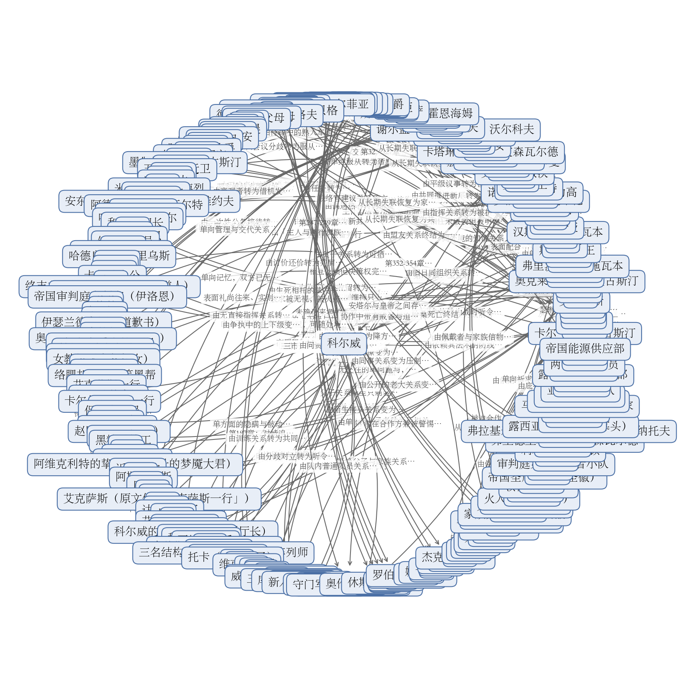

# 拆文报告：泛亚的异世界征程

> 一句话：这本书不靠一个人变强留住读者，靠的是「一整片大陆被扔进异世界」之后，几十个国家、上百个角色、三条战线怎么互相算计、互相碾压，又怎么把每一次胜利的代价一笔一笔记下来。
> 拆到哪：全书 366 章、约 155.4 万字，全部拆完（连载中，第366章是目前最后一章）。

## 基本信息

| 书名 | 题材 | 总章数 | 总字数 | 目标平台 |
|------|------|--------|--------|----------|
| 泛亚的异世界征程 | 异世界 / 群像 / 文明碰撞（作者声明无绝对主角） | 366章（连载中） | 约155.4万字 | 番茄小说 |

> 补充一句：第1章标题是「番外一」，第2、3章标题是「序章」，但它们不是外传或预热，而是整个故事真正的开头——先交代异变怎么发生、各国怎么应对，正文从第5章「两个世界的第一次接触」开始。

## 核心发现

1. **把「追一个人」换成「追一张局势图」，是它能写 366 章的根本原因**。作者在简介里直接声明没有绝对主角，全书出现章数最多的人物（科尔威）也只占 366 章里的 39 章。取而代之的是六条并行线：泛亚与伊瑟兰德的战争外交、伊瑟兰德的内部权力重组、血族与邪神的神性威胁、维洛斯本土社会与共助会、跨世界探索与技术源流、泛亚内部的国别博弈。六条线用五个汇流点对表——赤水港核平（第77-85章）、天竺决战（第118-122章）、灰烬海弑神（第143-163章）、圣冠加冕（第283-291章）、邪神仪式与远征军覆灭（第338-347章）。**你可以怎么用**：写群像时不要给每条线都安排主角，改成给每条线安排一个「议题」，线走到哪算哪，靠汇流点强制对表。

2. **所有爽感都建立在一条读者能复述的链条上，而不是主角光环上**。压制之所以可信，是因为每次都给全「侦测—制导—打击」三段：天眼二号扫描海域、055 舰逐条击沉黑牙舰队（第251章）；海狼无人艇广域电磁干扰把魔导炮、水下蛙人、空域骑士三条反击路径同时归零（第253章）。**你可以怎么用**：写技术代差时，别写「一炮轰碎」，写清楚对手为什么防不住（护盾功率、法阵被红外热源破解、魔力离体即崩解）。

3. **每一次前线胜利都被当场兑换成一份内部筹码**。战场胜负与朝堂账本始终同章对账：奥克莱尔把加急军报压在银制托盘下、以南方市场两成换北方舰队（第65章）；听证会上他当场认责后用四项质询夺权、398 票通过南方军管法案（第74章）；战后安塔尔提大清洗被否，转而借血族基因权限撤风墙、把兵源指向极东（第357章）。**你可以怎么用**：每打完一仗，立刻问「这一仗换谁下台」，把军事结果翻译成席位、法案、市场成数、赔款比例。

4. **代价清单与收益清单永远并置结算**。锚点系统启动后，把帝国军魔导装备和露西亚自己的通讯、无人机、GPS、雷达一起废掉，作战退回一战水平（第312章）；圣冠把活人灵魂改成超量信息容器，尤里安七窍渗血、全境限量供能（第285-286章）；米努辛斯克反打靠投送六百台动力装甲，代价是实验卫星预估一周内停摆（第321章）。**你可以怎么用**：爽点之后紧跟一张账单，且账单必须事后真的兑现——说卫星停摆就让它停摆，只提不结算会让爽点贬值。

5. **小人物不是用来煽情的，是用来承载宏观代价的**。诺尔丁荣光大街齐射后，小指头抱着沾血的白旗蹲在空街上放声大哭（第180章）；阿尔斯用五十金弗预支款把四个孩子卖给劳务派遣公司，妻子留一张「对不起」的纸条后割腕（第187-188章）；修卡马特的年轻士兵左臂中箭仍拒绝后撤，说自己死了弟妹就能拿绿卡（第305章）。**你可以怎么用**：把小人物的命运与主线节点同章咬合（赠书接共助会、绿卡接修卡马特清剿），孤立写苦难会被读作注水。

## 黄金三章评分

| 维度 | 评分（1-5） | 为什么这么打 |
|------|------|------|
| 开篇钩子 | 4 | 第1章不写灾难本身，只写手机刷不出新闻、雾大得离谱、海水变了味，让读者比角色先察觉不对；随后用「乌拉尔山脉不见了」独立成段落锤，冲击力给得很足。扣1分是因为两章之后钩子明显转弱——第2章变成多线并行的政情通报，第3章直接跳到「一个月后」改用编年史口吻。 |
| 主角塑造 | 2 | 作者在简介里就声明没有绝对主角，第1章的陈舟和第2章的王局都只出现一次。第2章的特鲁特夫是前三章最完整的一个（挽着袖子、攥着电报纸条、让十位州长当场表决），但也就这一场戏。按「人物能否立住」打分只能给2；按题材选择来说这是有意为之，不是写坏了。 |
| 爽点设计 | 2 | 前三章一次个人层面的爽点都没有：没有打脸、没有逆袭、没有机缘、没有升级。唯一的爽感来自「秩序对比」——华国民间「短视频照刷，消息照发，外卖照点」，跟南亚砸橱窗、南陆邦枪声放在一起，读起来是「我方稳」的踏实感。喜欢升级流的读者会不适应，作者在第4章标题里也提醒了「这本书可能不是你想的那种爽文」。 |
| 世界观铺设 | 4 | 规则交代得清楚又克制：外网消失、卫星全灭、三颗月亮、陆地被海洋切开，最后在会议桌上由科学家给出结论——「我们，连同一整片大陆，已经不在原先那个宇宙了」。所有异常都能在第3章收回，不靠旁白硬灌。扣1分是因为铺设量非常大，第3章连续几段都是名单、数据、组织名称，读起来偏文件。 |
| 章尾悬念 | 3 | 第1章「东方的整片世界，彻底不见了」、第2章「它别想从东部联邦区的岸上踩进来」都是很有力的断点，第3章却收在「缓缓重获新生」的完成态上，情绪是落定的；接下来能不能留住人，要靠「什么时候遇到这个世界的原住民」这个更远的期待。 |

## 读者在追什么

1. **看现代工业文明碾压魔法文明的代差爽感**。满足方式不是主角开挂，而是一条条可复述的技术链条；每次碾压都换新手段而不换逻辑（反舰导弹 → 电磁干扰 → 卫星制导 → 轨道投送），读者形成「这次换哪一层」的预期。满足之后还想往下看，是因为作者每次规模跳升前都先给出可量化的底牌存量（联合护盾功率降百分之五十三、通天塔聚能塔五千七百八十六座），读者会自己推算下一档。详见 [情绪模块.md](剧情/情绪模块.md)。

2. **看多个阵营各自算计的权谋**。战场胜负与朝堂账本同章对账，每一次前线胜利立刻被兑换成一份内部筹码。读者追的是「这一仗换谁下台」。

3. **看小人物在夹缝里挣扎的共情**。底层代价反复与主线并置，用书、粮食、赦免令、绿卡这些具体物件承载，读者会主动追问「这一家后来怎样」。

此外还有四条并行的期待：战争规模不断升级的壮阔、异世界社会被外力撬动的变化、认知颠覆与世界观拼图翻面、几万人规模的对峙与失控。

## 故事怎么推进

主线一句话：泛亚经济合作同盟从一场集体穿越里活下来，用技术代差和外交手腕，一步步把伊瑟兰德帝国从对手打成战败国，最后把自己变成这个世界的新秩序中心。主要副线三句：伊瑟兰德帝国的每一次对外失败都被内部改造成一次权力转移；血族与邪神的神性威胁逐级抬升，从城市尺度推到文明尺度；维洛斯本土的工人运动靠一本书、一次集会、一份铁路合同慢慢长出来，最终反过来撬动帝国。

**序章（第1-4章）**。主角想要什么：先弄明白发生了什么。卡在哪：外网消失、卫星全灭、星空对不上号，没有任何外部参照。靠谁翻过去：靠制度和科学，华国成立应急委员会、北陆联邦东部十州当场授权特鲁特夫、科学家在会议桌上落锤「不在原先那个宇宙」。得到什么、付出什么：得到泛亚经济合作同盟这个框架，付出的是「回不去」这个前提。引出下一段：既然回不去，就要知道这片大陆上还有谁。

**第一次接触与立威（第5-36章）**。泛亚的科考船队在海上遇到精灵船长特利尔和维耶拉家的长女艾丽莎，随后在沙勒曼岛清剿海盗、在奥伦港与血族舰队交锋，击落追击舰队后迫降长白山。卡在哪：对手是本地势力，泛亚对地形、规矩、语言全都不熟。靠什么翻过去：一次性能落差。得到什么：一份荒原立约和一次谈判桌上的位置。引出下一段：既然能立威，就能宣战。

**国家战争（第37-122章）**。别廖佐夫卡血战与传送门追击持续二十四章，是全书第一段大篇幅战役。第62章泛亚正式宣战伊瑟兰德，铁崖号覆灭、赤水港覆灭、帝国问责，直到终末之神降临赤水港，泛亚用一次核打击收场，双方签下停战协定。得到什么：停战、赔款、矿石和港口；付出什么：核武器从底牌变成常规选项。引出下一段：帝国本土的空虚。

**帝国本土与工运线（第123-244章）**。这是全书节奏最慢也最细的一段。穿越者火种引发帝国动荡，代理人诺亚与灰烬海浮出水面，逆神仪式在核弹压阵下完成，梦魇之主陨落。随后故事重心落到诺尔丁城：铁路与血案、思想扎根东区、灭鼠与东区接管。卡在哪：科尔威和他的共助会没有武装、没有钱、没有合法身份。靠什么翻过去：靠铁路、书和一次集会。得到什么：一个能自我扩张的组织；付出什么：荣光大街的齐射、七万人上街、当场死亡三百余人、被捕五千六百人。引出下一段：帝国的报复。

**第二战线与神性威胁（第245-337章）**。沙勒曼岛跨海商路开通后，诺尔丁清算与沙勒曼遇袭把战火重新点燃。维洛斯海战以禁咒破灭收场，萨南沙围城、圣冠加冕与无人机海把帝国逼到动用国土法术集群。修卡马特匪患清剿后开辟第二战线，锚点反噬导致帝国本土被打穿：米努辛斯克绞肉场、天降轨道传送、钢铁之躯与低空猎杀。得到什么：八万帝国军投降、第六军团南撤；付出什么：轨道投送把卫星寿命烧掉、锚点把双方的电子设备一起废掉。引出下一段：一场必须签的条约。

**战后（第338-366章）**。战后和谈与帝国软性重建、万国来朝与泛亚内部博弈、十二万战俘换南方人口，最后三章写归国战俘、南方劳务移民与一次短暂的温馨。得到什么：赔款、市场、人口；付出什么：官方公布九百九十七万、实际超过两千万的死亡差额。最后以一次归乡和一份「三天内归队」的命令收尾。

细节见 [剧情/](剧情/README.md) 下的 45 段剧情。

## 人物与关系

**主角**：本书没有绝对主角。科尔威是单条故事线最长、章数最多的视角人物（第175-247章），诺尔丁城的工人，从被通缉的印刷工成长为共助会领袖；他想要的是把一套外来思想种进帝国工人里，在故事里承担「帝国内部裂缝」这条线。作者在简介里明确声明没有绝对主角，全书写的是多个国家、整片大陆进入异世界之后的影响。

**主要对手**：伊瑟兰德帝国一侧。奥克莱尔（帝国大王子）是全书最完整的权谋对手，第60章亲口承认远征由他推动，第310章投送四十到五十万军队到泛亚本土；温布顿（帝国议长）是帝国体制的操盘手，第285章把凡人尤里安改造成圣冠的运算核心；卡尔·冯·奥古斯汀（帝国远征军总指挥）是对外战争的门面，第64章投降当天被议会剥夺皇室姓氏。神性一侧：女教长（梦魇教会，第115-117章占据安德拉港并升为恶魔大君，第121章身死）、阿维克利特（永眠者末代教皇，第144章转为弑神者，第152章率全族自爆献祭）、纳赫特玛（第343-347章）。

**核心配角**：阿尔斯（诺尔丁老工人、共助会技术骨干，第187-188章卖子丧妻）、薇薇安（血族皇女，第20-341章横跨全书）、伊洛恩（审判庭大审判官，第81-147章）、王伟（泛亚外交负责人，第9-278章）、米娅（薇薇安的护卫，第10-341章）、艾丽莎（维耶拉家长女、泛亚的引荐人，第5-97章）、艾伦与格鲁（共助会组织者与武装指挥，第202-296章、第229-247章）、莱拉与艾克萨斯（冒险者与通译，第98-354章、第98-163章）。

关系图见 [人物关系图.md](人物关系图/人物关系图.md)：

全书共记录 252 条有向关系。关键关系的变化：

- 科尔威 → 阿尔斯：由同城工友到共助会的组织核心与技术核心（第175-192章，因为两人一起把工人协会办起来）。
- 阿尔斯 → 科尔威：由被救者到把命交出去的追随者（第188章，因为科尔威把他从河里拽上岸）。
- 奥克莱尔 → 卡尔·冯·奥古斯汀：由祖孙到公开的政治除名（第64章，因为远征军全线崩溃、卡尔被俘）。
- 卡尔·冯·奥古斯汀 → 奥克莱尔：由臣属到彻底割裂（第109-112章，因为引渡名单与除名公告送达战俘营）。
- 奥克莱尔 → 温布顿：由公开的议长与皇子关系，转为私下的共谋同盟（第75章，因为听证会成功后的私下会面）。
- 温布顿 → 尤里安·冯·戈尔菲亚：由加冕者与被献身者（第285-288章，因为皇帝无法亲自主持国土法术集群，温布顿需要一个自愿的承载者）。
- 汉克 → 克洛维：由码头工同事到告发者（第232章，因为汉克被分化后把伏击布置交了出去）。
- 黑牙 → 陈平：由海盗头目到挟持人质（第251章，因为舰队被导弹摧毁，只剩人质一条活路）。

## 读者知道的和角色知道的

- **「这片大陆已经不在原先那个宇宙了」**：第1-2章发生，读者在第1章就靠现象察觉不对，第3章由科学家落锤；大陆上的普通人直到第3章才被正式告知。这个时间差撑住了前四章的全部悬念。
- **前代地球穿越者的存在**：第125-126章由米涅枪的膛线证明——有人早把成熟成品技术整段搬来过；林晓在第125-126章推出线索，第130-132章被通缉后才把情报交出去。读者比帝国朝堂早知道近千年前就有同类技术。
- **极东灵界的人工穹顶**：第207章成像出闭合环形巨城、塔尖暗红烈阳迸出「何人胆敢，窥视天庭」；泛亚在第209章得到回应。这条线到全书结束仍未兑现。
- **圣冠的真相**：第285章温布顿为尤里安加冕时，读者与温布顿同时知道圣冠把活人改造成运算核心；尤里安本人是自愿的，但直到七窍渗血才明白代价。
- **帝国全盘让步**：第348章读者已知皇帝下令全盘接受条件，泛亚代表却对逐条应下毫无准备。读者比谈判桌上的人多知道一层。
- **锚点的双向代价**：第312章锚点启动，读者立刻知道帝国与露西亚的电子设备一起废掉；帝国军方直到装备失效才反应过来。

详见 [节奏.md](剧情/节奏.md) 的「关键双时间线」。

## 节奏

- **事情推进**：推得最快的是第37-60章（别廖佐夫卡血战到传送门追击，24 章打完一场战役）、第262-312章（维洛斯海战到第二战线，51 章里换了三次战场）、第306-366章（11 段剧情、14 条高潮记录连续压上）。明显在铺垫的是第184-244章（诺尔丁工运线，连续 61 章只有两次大高潮）和第348-366章（战后谈判与归乡，连续 19 章低烈度）。主要转折落在第77-85章（赤水港核平）、第118-122章（天竺决战）、第143-163章（灰烬海弑神）、第283-291章（圣冠加冕）、第338-347章（远征军覆灭）。
- **读者情绪**：高点集中在第62-122章与第245-337章两段；低谷最长的是第184-244章，作者用街头组织、劳工运动、家庭悲剧和一段荒诞缓冲（第201章不抽一分工钱、当日登记两百多号）把它撑住。第211-221章的沙勒曼岛商路段（11 章）几乎没有战斗，是全书的商业缓冲带。
- **笔墨分配**：作者在仪式与装备参数上花大篇幅（第283-288章圣冠加冕写足六章、第298-301章固态电解质能量密度写到小数点），在行军、补给、日常通勤上一笔带过。这样安排的效果是让「规模」始终可核对，代价是政治会议段落偏文件化。

### 爽点密度

大约每 6-8 章一次中高潮、每 12 章左右一次大高潮，密度**偏高**。最长的空档在第 184-244 章，作者用「铁路—书—集会」这条缓慢但持续上升的社会改造线撑住，中间用第201章的组织扩张、第215-218章的跨海换货、第225章的七万人上街分段补给。

## 伏笔与冲突

**跨章较远或影响主线的伏笔**：

- 干扰源在南荒海域（第10章）→ 血月旗舰队南下（第20-21章）→ 奥伦港交锋。埋下 10 章后揭开，读者读到「原来第一天那个信号是他们」。
- 极东近千年前已有同类技术（第125章）→ 情报交到李锐手中（第133章）→ 肉桂因罡风层断供（第158章）→ 入轨（第204章）→ 穹顶巨城（第207章）→ 符文阵列被击穿（第208章）。跨度 80 余章，到全书结束仍未收束，是最大的一条未结算线。
- 通天塔半数魔能去向不明（第286章）→ 赤水港城防法阵未启动（第289章）→ 圣冠接入综合人口管理系统（第349章）。揭开时读者意识到帝国早就把国运押在活人身上。
- 圣冠加冕（第283-291章）与战后「全盘接受条件」（第348-350章）互为因果，读者在读到初代种换血议会时会回头确认第285章那一针扎下去意味着什么。

**冲突升级路径**是六级台阶，每一级都由上一级的结果直接打开：个体与据点级（第5-8章共识号与黑船）→ 舰队与要塞级（第62-69章宣战与铁崖号）→ 国家战争级（第70-85章赤水港与核平）→ 神明与近神级（第143-163章灰烬海弑神）→ 战略武器与轨道投送级（第313-337章锚点反噬与轨道云爆弹）→ 战后秩序与人口交易级（第348-366章）。最后落到一张谈判桌上：赔款从三百八十六亿砍到约六千万帝国金镑，帝国南方拆成七八个国家，每年六十亿金镑、六十年。

## 核心机制

- **反复使用的爽点类型**：代差碾压（换手段不换逻辑）、权谋对账（一仗换一个席位）、绝境反打（先写足绝望的可数刻度）、条约清算（把胜利写成账单）。
- **节奏套路**：每段高压战争之后固定插入一段「规矩立起来」的低强度段落（第86-96章围堵治安署与判决、第211-218章以货换货与驻军见证备案），让读者知道大战之间必有荒诞缓冲。
- **更新上的做法**：单章通常只跟随一个视角，切换靠场景自然过渡；每一轮规模跳升前先给出可量化的底牌存量；每次揭秘至少回收一条早期伏笔。

## 角色体系

- **主角**：无。科尔威（第175-247章）是章数最多的视角人物，承担帝国内部裂缝这条线。
- **对手**：奥克莱尔、温布顿、卡尔·冯·奥古斯汀（帝国权力线）；女教长、阿维克利特、纳赫特玛（神性威胁线）；黑牙、哈立德、克洛维（地方与底层对手）。
- **核心配角**：阿尔斯、薇薇安、伊洛恩、王伟、米娅、艾丽莎、刘卫东、奥卡姆、瑟琳娜、特利尔、艾伦、格鲁、莱拉、艾克萨斯、汉克、休格洛夫、赵明远、林晓等，共 41 人写了完整档案。
- **功能性角色**：46 人写了简化档案，承担信息、道具或一次性互动，如王富城（跨海商路）、尼基切夫（验矿）、特兰斯（矮人符文师）、加文·艾尔卡斯（商人）、雷耶斯（帝国之刃号舰长）。

全书共 87 份人物档案，见 [角色/](角色/角色关系.md)；16 个势力与 4 份世界观设定见 [设定/](设定/世界观/背景设定.md)。

## 可借鉴套路

1. **越级打击与围观者认知崩塌**：不写主角自夸，写旁观者的认知崩塌与转述。第33章克里斯托弗·李一枪打落隐形双足龙，让格瑞赛斯军方与王室当场重估使团；第328章帝国军团长埃尔温翻遍战史找投降先例，双手托出刻符文的军刀。用他人反应代替宣言，可信度更高，而且传播链本身就是世界规模的量尺。对应情绪模块卡「越级打击与围观者认知崩塌」（EM-001）。
2. **两界差价与规矩滞后**：差价不写成暴富，写成互相解死结。审判庭把核废料当圣物买下，乏燃料按两公斤黄金一公斤成交、附带三百吨黄金与一百六十万颗魔晶（第113-115章）；加文押上全部现钱买二十多万吨矮人矿石出港（第211-218章）。对应「两界差价与规矩滞后」（EM-002）。
3. **战后条约清算与内部政治分赃**：把胜利写成账单而不是加冕。赔款从三百八十六亿砍到约六千万帝国金镑（第348-350章）；艾德尔把「三名壮劳力配套家属换一人」改名「劳务派遣」（第362章）。对应「战后条约清算与内部政治分赃」（EM-003）。
4. **代理人扶持与遥控感**：泛亚极少直接支持共助会，二者靠一本书、一次集会、一次外交照会间接接通；南方厂主奥姆卡雇黑牙袭击沙勒曼岛、要求不留帝国痕迹，黑牙却把目标私改成永兴号渔船。对应「代理人扶持与遥控感」（EM-004）。
5. **小人物在夹缝中的抉择**：第242章守门军官因一袋麦子的旧恩放走艾伦；第360章卡塔琳娜报十五金镑被当场算账。对应「小人物在夹缝中的抉择」（EM-005）。
6. **工业怪兽对旧式武力的碰撞**与**旧装备小单位的绝境反打**：前者见第326章第13重装合成旅六小时打崩第四军团，后者见第27章启用克劳特1077型75毫米步兵炮突围、第324章队长以连接战法把六名骑兵魔力聚到核心位击落一架A30。对应「工业怪兽对旧式武力的碰撞」（EM-006）与「旧装备小单位的绝境反打」（EM-007）。
7. **硬倒计时与最后期限**：第321章707项目第三次实验、实验卫星预估一周内停摆；第337章传送门侧士兵哭着要回家。对应「硬倒计时与最后期限」（EM-008）。

另有 16 条索引级机制值得单独借用：单章群像并列切景、制度与条文落地、包围与双重包围、长线伏笔按固定间隔复现、反派视角的幻灭、代理人换装与技术扩散、民间贸易与货币不通、邪神恐怖与宗教线、饥饿与贫困的生存线、单章笑点与荒诞调剂、装备参数与说明书段落、消耗战与绞肉段、跨地理区并线、帝国侧内裂清算、资源与矿产杠杆、绝境反杀与临场改打法。见 [情绪模块.md](剧情/情绪模块.md) 的「其他机制索引」。

## 可复现模块

**越级打击与围观者认知崩塌（EM-001）**。读者想看什么：看强者被当众证明是强者，而且是通过别人的眼睛。情绪链：轻慢 → 出手 → 旁观者失语 → 转述扩散。戏剧单元：一次被迫的亮相，配一个必须被说服的旁观者群体。可替换项：武器、场合、旁观者身份都能换。不可照搬：围观者必须各有立场和利益，不能是一群只会喊「好强」的背景板。

**两界差价与规矩滞后（EM-002）**。读者想看什么：看现代人用常识在异世界占便宜，且占得有理有据。情绪链：对方不懂 → 我方开价 → 对方抢着成交 → 事后才发现差了多少。戏剧单元：一次双方都觉得自己赚了的交易。可替换项：商品、买家、交易场合都能换。不可照搬：差价必须同时解决对方的死结（审判庭得到唯一能根除污染的圣物），单向掠夺会让交易段失去说服力。

**战后条约清算与内部政治分赃（EM-003）**。读者想看什么：看胜利兑现成可核对的条款，以及看输的那一方内部怎么分赃。情绪链：战场落幕 → 谈判桌拉锯 → 条款落地 → 内部清洗。戏剧单元：一张桌子、两份清单、三方以上各怀心思。可替换项：赔款形式、领土处理、人口交易方式都能换。不可照搬：收尾段若连续堆条款与数字会变成信息型章节，必须用个体落点收束。

## 写法技巧

1. **一笔两用**：同一个物件在不同章段承担不同功能。书在第184-192章是思想载体，在第225章是集会的召集信号，在第242章是守门军官放人的理由。
2. **延迟揭示**：第3章一句「已经不在原先那个宇宙」统一前面全部异常，但作者先让读者在第1章靠现象自己察觉，把解释推迟两章。
3. **视角欺骗**：第20章赫凡特占卜看到舰队覆灭的幻象、嘶吼「千万不要去」，薇薇安仍以血瞳判定无事、下令南下。读者跟着薇薇安误判，直到奥伦港才被纠正。
4. **对比锚点**：同一场灾难，六地并列，一地只给一个标志性画面——监测中心是警报和「三颗月球」，北都是烟头堆成小山的会议室，南亚是砸橱窗，瀛洲是吞硬币不出货的自动贩卖机，北原是「咋还多了俩」。全景感靠画面差异建立，不靠时间线推进（第2章）。
5. **行为循环**：每段高压战争后固定插入一段「规矩立起来」的低强度段落，读者形成「大战之间必有荒诞缓冲」的阅读节奏。
6. **用身体反应代替心理描写**：王局手指压在纸面上微微发抖，然后立刻恢复冷静下达命令；尤里安七窍渗血；阿尔斯投河被拽上岸。作者极少直接写「他很痛苦」。
7. **跨章回扣**：第1章的断网、怪雾、海水变味，在第3章由科学家给出机制解释；第285章那一针扎下去，到第349章才让读者看清它接管的是整个帝国的人口管理。

## 不建议模仿

1. **前四章的信息密度过高**。第2-3章连续几段都是名单、数据、组织名称和表决过程，读起来偏文件；第4章甚至要用标题提醒读者「这本书可能不是你想的那种爽文」。要写群像开篇，建议把组织介绍拆到后面的情节里分批给。
2. **长线未结算项开得太多**。极东天庭与灵界古老存在、埃里希与血族首都传送门的空白段、黑牙与奥姆卡的下场、诺尔丁伯爵的抗税调查，到第366章都没有收束。开长线本身没错，但同时挂七八条且不给阶段性回收，读者维护「还没结」清单的成本会越来越高。
3. **政治会议段落偏文件化**。第3章、第74章、第348-350章都有整段会议纪要式的写法，虽然票数、条款、赔款比例都可核对，但连续阅读容易失焦。建议每段会议至少配一个具体动作（奥克莱尔把军报压在银制托盘下就是好例子）。
4. **视角切换过密时缺少时间锚点**。全书有六个阵营、三条地理战线，单章通常只跟随一个视角，切换靠场景自然过渡。这在交汇章节没问题，但在第123-183章、第245-305章这类多线并进的段落里，读者容易丢失「现在是哪一天、哪一边先发生的」。
5. **第184-244章的节奏对平台不友好**。连续 61 章把主要冲突从战争降级为街头组织与劳工运动，大高潮只有两次。这是作者有意的写法，移植到其他平台前需要确认读者能接受这种长度的低烈度段。

## 文风一句话

句子偏短、段落偏碎，大量使用独立成段的单句做锤点；叙述冷静克制，很少直接写情绪，改用身体反应和器物细节代替；对话密度不高但每句都带立场，公文腔、军事术语和口语方言混在同一章里；战争段落靠参数和型号建立可信度，日常段落靠荒诞调剂松神经。详细见 [文风.md](文风.md)。

## 还不确定的地方

- 全书 366 章全部拆完，没有漏拆的章。
- 推测：帝国皇帝在全书后半段长期沉默，可能是在为「皇帝也不是这个世界的」这条线留位置，依据：第362章艾德尔自述皇帝也不是这个世界的、第253-255章温布顿望向漆黑无灯的王座大厅。
- 推测：伊万诺夫这个名字可能指向四个不同的人（第7章共识号无人机操作员、第38章上尉、第51章上将、第255章东湾市长），原文没有给出明确的同一性说明，本报告按四个人分别记录。
- 推测：纳赫特玛与薇薇安的关系。第342章的摘要以「纳赫特玛（薇薇安）」并列标注、第344章由灰色骑士判定其前身为薇薇安，但第343章原文又写「咱可不是薇薇安」，两处口径不一致，暂按「前身是薇薇安、本人否认」记录。
- 原文内部有一处专名不一致：第327章与第329章写「埃尔温·冯·多恩贝格」，第328章写「埃尔温·冯·贝格多恩」，本报告统一用前者。
- 人物关系图已生成图片版（核心人物关系.png），但没有另出「关键关系演变.png」。

### 本阶段偏差披露

- **文风.md 超出 4000 字规范**，实际 10800 字。超出部分主要是原文锚点片段的分段引文与「不可模仿」清单。压到 4000 需要删掉实测引文，而引文正是判断文风可用性的依据。照实保留并披露。
- **文风锚点 7 个，超出规范 4-6 个。** 本书基调动辄横跨七种以上，多取两个锚点是为了覆盖差异化更大的写法。照实保留。
- **37 份角色档案的六节正文超出 500 字规范**（占 41 份有六节正文的完整档案的 90%），最长 奥卡姆 974 字。超出来的是人物的完整经历与关系走向，压缩后会丢掉下游最依赖的「这个人做过什么、跟谁什么关系」。照实保留并披露。
