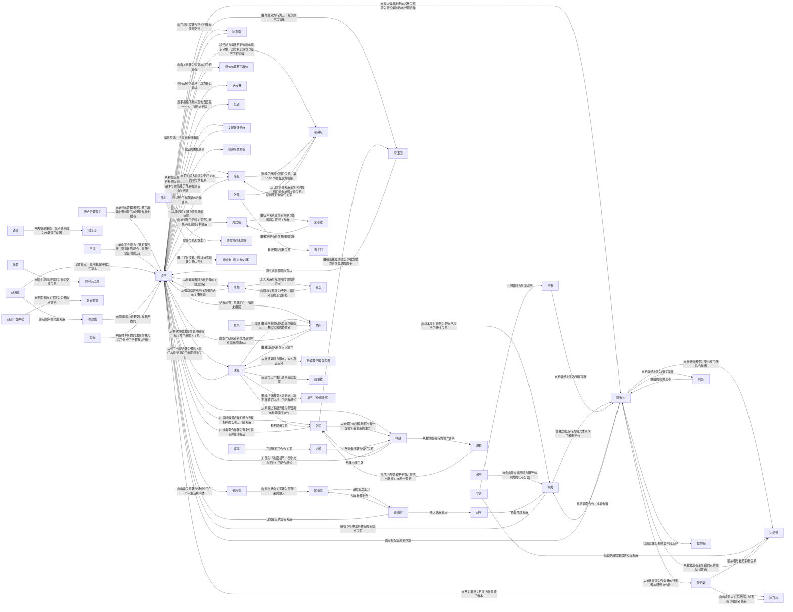

# 人物关系图：重生核电站，开启哈基人拾取模式

> 由 角色/角色关系.md 生成；关系事实以该文件为准。图片版见同目录的 PNG。

## 核心人物关系

- 凌宇 → 沈雁：从单次救援发展为长期授权与关照的代理人关系
- 沈雁 → 凌宇：从纯工作配合转为带私人信任与查证意识的长期质询关系
- 凌宇 → 张武：由实时情报合作扩展为授权指挥的长期上下级关系
- 张武 → 凌宇：由戒备型合作转为有条件信任并主动接活
- 凌宇 → 林越：从单纯上下级升级为带玩笑的长期授权协作
- 林越 → 凌宇：扩展为「地面机甲＋空中火力平台」的配合模式
- 凌宇 → 苏晚：合作加深，隐瞒仍在，追查未撤回
- 苏晚 → 凌宇：由合作研究者转为对基地本身提出质疑的人
- 凌宇 → 陈默：长期战场分工与默契的协作关系
- 陈默 → 凌宇：由战场协同扩展为情报搜集协同
- 凌宇 → 顾长川：从单人请求出走的松散关系变为正式编制内的长期协作
- 顾长川 → 凌宇：固定搭配延续到末章
- 凌宇 → 李定国：由陌生双方转为上下级与默许式信任
- 李定国 → 凌宇：默许式信任而非盲从
- 凌宇 → 陆震南：由互相试探转为正式归建与情报交换
- 陆震南 → 凌宇：情报互通、旧事被重新审视
- 凌宇 → 柳微月：凌宇成为柳微月可依赖的倾诉对象，双方真实身份与经历互不知情
- 凌宇 → 周启明：由被识破的伪装关系变为被孩子接受的守护关系
- 凌宇 → 唐依依等孩子群体：由看护者转为刻意放权的培养者
- 唐依依等孩子 → 凌宇：从单纯的管理者变为孩子群体中带绰号的威慑者与被支援者
- 凌宇 → 伊芙琳：保持敌对未结算，双方各自备战
- 凌宇 → 陆百川：从敌对据点头目变为被处置的样本
- 凌宇 → 低语：凌宇拒绝飞升并宣告自己是一个人，对抗未根除
- 凌宇 → 文明跃迁系统：从初始任务列表扩展为覆盖行星级防御与跨深渊跃迁的兑换体系
- 文明跃迁系统 → 凌宇：绑定关系延续，飞升选项被永久搁置
- 凌宇 → 张静等教育者：稳定的委托关系
- 沈雁 → 苏晚：由同路躲避转为能互相纠正判断的讨论伙伴
- 苏晚 → 沈雁：由独自研究转为带人协作
- 沈雁 → 张武：稳定同僚关系
- 张武 → 林越：从被保护的新兵到可独当一面但仍受管束的主力
- 林越 → 张武：纪律约束生效
- 陈默 → 柳微月：延续的亲属式照护关系，第157-159章兑现为相拥
- 柳微月 → 陈默：从日常亲属关系变为明确的照护者与被照护者关系
- 周启明 → 宋小敏：由玩伴关系变为带保护与警戒成分的同行关系
- 宋小敏 → 周启明：由被保护者转为并肩的同伴
- 钱进 → 钱乐乐：从失联到重逢，父子关系成为他转变的动因
- 张静 → 柳微月：临时照护与信任关系
- 张静 → 孩子们：新增带队管教关系
- 王海 → 凌宇：由单向下令变为「认可其判断并愿意冒险配合、但硬性禁止时服从」
- 赵海生 → 凌宇：合作稳定，赵海生避免被当作怠工
- 赵海生 → 徐建国：固定的午后酒友关系
- 徐建国 → 凌宇：从质疑转为成果交付与量产协同
- 方毅 → 林越：由敌对盘问转为信任关系
- 郑海 → 方毅：互相认可的合作关系
- 顾长川 → 沈栖迟：从被救济者变为受约束的随队合作者
- 顾长川 → 周予棠：从被救者变为受委托的行刑者与研究协作者
- 周予棠 → 陆百川：由救命恩人关系反转为加害者与被害者关系
- 顾长川 → 刘禹：维持表面合作、戒备未消
- 刘禹 → 顾长川：由独立据点转为曙光体系内的桂港分支
- 刘禹 → 凌宇：授权与暗中观察并存的带疑点关系
- 苏晚 → 刘禹：由样本提供者变为带监控义务的托付关系
- 凌宇 → 叶楚：从被观察者转为被依赖的关键观测者
- 叶楚 → 凌宇：从被质疑的观察转为被确认的关键线索
- 叶楚 → 秦蕊：恋人关系升级为共同冒险的绑定
- 秦蕊 → 叶楚：由搭档关系变为经受住拟声考验的互信搭档
- 顾南絮 → 陈清雨：战友默契上升
- 陈清雨 → 顾南絮：战友默契上升
- 顾南絮 → 凌宇：日常互怼式信任关系
- 顾长川 → 阿豪：从日常好友变为远征同伴
- 阿豪 → 顾长川：熟络的同僚互动
- 老宋 → 顾长川：从日常好友变为远征同伴
- 顾长川 → 张修明：已成过往但持续影响其选择
- 寸头 → 沈栖迟：借出护盾发生器的照应关系
- 寸头 → 老宋：由闲聊转为共同迎战
- 陆实 → 陈默：从陌生闯入者变为受庇护的向导与情报源
- 陆实 → 清风苑四名同伴：同伴关系名存实亡
- 陆实 → 寒岭市（家乡与父母）：由「早有准备」的自我欺骗转为确认丧失
- 夏风 → 苏晚：由西南基地研究员变为砺山核心实验的协作者
- 何秋萍 → 陈清雨：由单次救命关系转为互有往来的熟人
- 顾南絮 → 赵军：熟人关系稳定
- 秦霄 → 顾长川车队：从陌生武装相遇变为物资交换关系
- 赵四／血神帮 → 秦霄营地：从定期征收关系变为公开敌对关系
- 李光 → 凌宇：从临时军事协同发展为并入后的重点任务首选执行者
- 张武 → 李定国：由砺山独立团团长与被支援方转为张武的副手
- 周毅 → 张武：形成「先收复中平省、后向外救援」的统一意见
- 林越 → 周毅：从被救助者转为协作关系
- 沈雁 → 孙媚及不服指挥者：从被质疑转为服从，众人真正安分
- 沈栖迟 → 顾长川：从被救济者变为受约束的随队合作者
- 周予棠 → 沈栖迟：照护者与被照护者关系
- 乐空 → 刘禹：协会由独立据点转为曙光体系内的桂港分支
- 赵军 → 刘禹：协会成员关系
- 沈雁 → 唐依依：亲密与工作委托关系继续加深
- 凌宇 → 何秋萍：由救助关系转为组织化的生产—生活共同体
- 沈雁 → 凌宇（身份疑点）：形成「沈雁提人道诉求、凌宇保留否决权」的协作模式

## 关键关系演变

- 宋小敏 → 周启明：由日常兄妹关系变为明确的保护者与被保护者关系（第52-54章听到凌宇称周启明为英雄并投影徽章） → 由被保护者转为并肩的同伴（第157-159章她转告周启明花种长出来了）
- 秦蕊 → 叶楚：恋人关系升级为共同冒险的绑定（第217-219章凌宇当面说明此行也许会死） → 由搭档关系变为经受住拟声考验的互信搭档（第223-225章六号艇异常密度最高，门外出现模仿她声音的诱骗）
